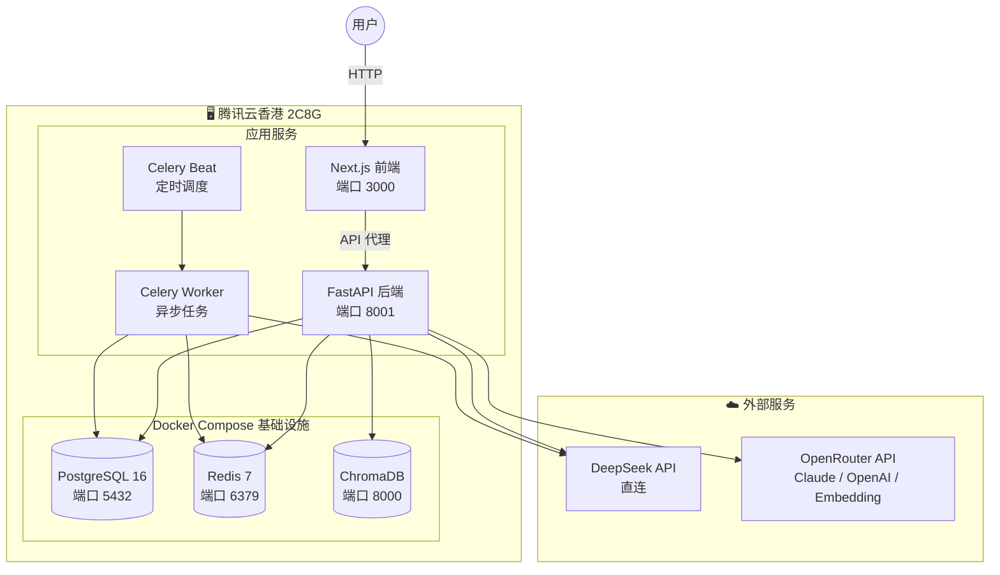
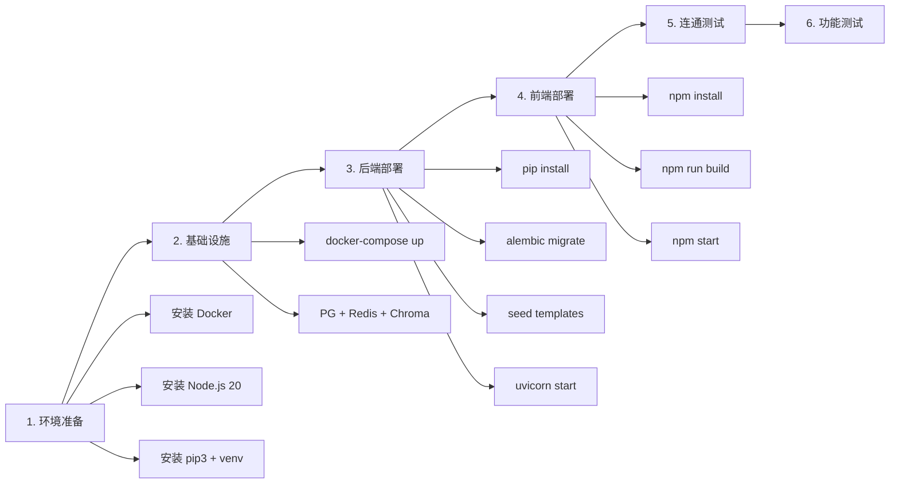

# 01 - 部署方案与架构概览

> 文档创建时间：2026-04-13  
> 服务器：腾讯云香港 · 锐驰型 2核8G-80G-200Mbps · Ubuntu 24.04 LTS

---

## 1. 系统架构总览

## 2. 确认的部署策略

| 决策项 | 方案 | 说明 |
|--------|------|------|
| **LLM 主力** | DeepSeek 直连 | `sk-ebe...eb79`，余额 6.88 CNY |
| **LLM 辅助** | OpenRouter 中转 Claude/OpenAI | `sk-or-v1-a57b...3dd6`，余额 2.89 USD |
| **Embedding** | OpenRouter → `text-embedding-3-small` | 消耗 OpenRouter 余额 |
| **社交分发** | 跳过 | 初始阶段不配置 Telegram/Twitter |
| **支付/存储** | Mock 模式 | `PAYMENT_PROVIDER=mock` |
| **测试范围** | 基础连通 + 功能性测试 | 注册/登录/情报/AI分析跑通 |
| **内存策略** | 优先核心服务 | ChromaDB 可酌情停用；前端生产模式 |

## 3. 部署流程

## 4. 资源预算（8GB 内存分配）

## 5. 发现的配置问题（待修复）

| # | 问题 | 位置 | 修复方案 |
|---|------|------|----------|
| 1 | 数据库名不一致 | `alembic.ini` 写了 `intel_agent`，`.env` 是 `intel_engine` | 统一为 `intel_engine` |
| 2 | JWT Secret 未更换 | `.env` 第9行 | 生成随机密钥替换 |
| 3 | Embedding 未配置 OpenRouter | `.env` 第47-50行 | 填入 OpenRouter 端点和 Key |
| 4 | Claude/OpenAI Key 未配置 | `.env` 第17-18行 | 填入 OpenRouter Key |
| 5 | `config.py` 默认 `DEEPSEEK_BASE_URL` 缺少 `/v1` | `backend/config.py` 第22行 | `.env` 中已正确，无需改 config |

## 6. 端口映射表

| 服务 | 端口 | 协议 | 说明 |
|------|------|------|------|
| Next.js 前端 | 3000 | HTTP | 用户访问入口 |
| FastAPI 后端 | 8001 | HTTP | API 服务 |
| PostgreSQL | 5432 | TCP | 仅 localhost |
| Redis | 6379 | TCP | 仅 localhost |
| ChromaDB | 8000 | HTTP | 仅 localhost |
