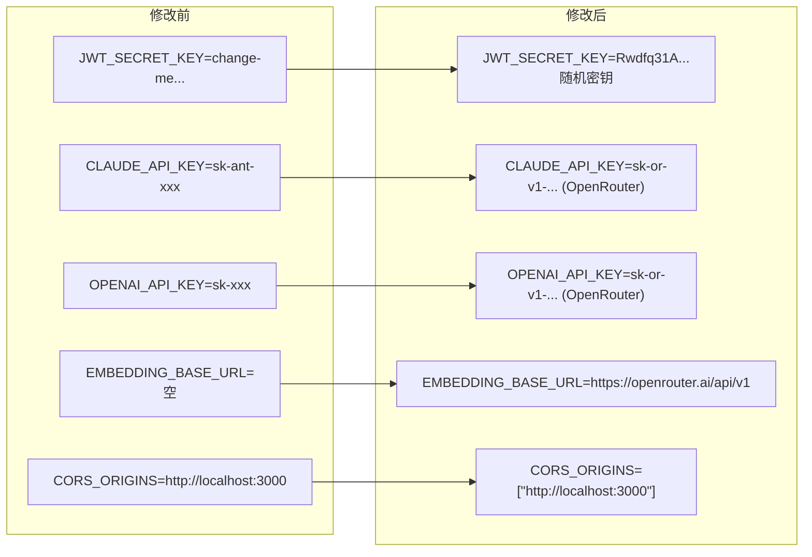

# 02 - 环境配置与修复记录

> 文档创建时间：2026-04-13  
> 服务器：腾讯云香港 · 2核8G · Ubuntu 24.04 LTS

---

## 1. 环境安装时间线

```mermaid
gantt
    title 环境安装时间线
    dateFormat HH:mm
    axisFormat %H:%M

    section 系统工具
    pip3 + venv + build-essential  :done, 01:34, 01:35
    
    section Docker
    Docker CE 29.4 + Compose 5.1  :done, 01:35, 01:36
    
    section Node.js
    Node.js 20.20 LTS             :done, 01:35, 01:36
    
    section 基础设施
    docker compose up (PG/Redis/Chroma) :done, 01:36, 01:37
    
    section 后端
    pip install requirements.txt   :done, 01:37, 01:39
    
    section 前端
    npm install                    :done, 01:37, 01:38
    npm run build                  :done, 01:44, 01:45
```



## 2. 已安装软件版本

| 软件 | 版本 | 安装方式 |
|------|------|----------|
| Docker CE | 29.4.0 | apt (docker.com 官方源) |
| Docker Compose | v5.1.2 | docker-compose-plugin |
| Node.js | 20.20.2 | NodeSource apt |
| npm | 10.8.2 | 随 Node.js |
| Python | 3.12.3 | 系统自带 |
| pip | 26.0.1 | apt + 升级 |
| PostgreSQL | 16-alpine | Docker 镜像 |
| Redis | 7-alpine | Docker 镜像 |
| ChromaDB | latest | Docker 镜像 |

## 3. 发现并修复的问题

### 3.1 config.py env_file 路径错误

**问题：** `backend/config.py` 中 `env_file = "../.env"` 是相对于 CWD 的路径。当从项目根目录运行 `uvicorn backend.main:app` 时，CWD 是项目根，`../.env` 指向上层目录（不存在），导致 `.env` 不被加载，所有配置回退到默认值。

**修复：** 改用基于文件位置的绝对路径：

```python
_ENV_FILE = Path(__file__).resolve().parent.parent / ".env"
# model_config 中使用 str(_ENV_FILE)
```

**影响：** 无论从哪个目录启动，都能正确加载项目根目录的 `.env`。

### 3.2 alembic.ini 数据库名不一致

**问题：** `backend/alembic.ini` 中 `sqlalchemy.url` 使用了 `intel_agent`，但 `.env` 和 `docker-compose.yml` 中数据库名为 `intel_engine`。

**修复：** 将 `alembic.ini` 中的数据库名统一为 `intel_engine`。

### 3.3 CORS_ORIGINS 格式错误

**问题：** `.env` 中 `CORS_ORIGINS=http://localhost:3000` 是纯字符串，但 `config.py` 声明为 `list[str]`。pydantic-settings 尝试 JSON 解析时失败。

**修复：** 改为 JSON 数组格式：`CORS_ORIGINS=["http://localhost:3000"]`

### 3.4 bcrypt 版本不兼容

**问题：** bcrypt 5.0.0 与 passlib 1.7.4 存在已知兼容性问题。新版 bcrypt 拒绝长度超过 72 字节的密码参数（在 passlib 内部检测逻辑中触发），导致注册/登录时抛出 `ValueError`。

**参考：** [passlib Issue #190](https://github.com/pyca/bcrypt/issues/684)

**修复：** 降级 bcrypt 至 4.0.1：`pip install bcrypt==4.0.1`

### 3.5 seed_templates.py 导入名不匹配

**问题：** `scripts/seed_templates.py` 导入 `from backend.database import async_session`，但 `database.py` 只导出 `async_session_factory`。

**修复：** 在 `database.py` 中添加别名：`async_session = async_session_factory`

## 4. .env 配置变更总结



## 5. 资源使用情况（部署完成后）

| 指标 | 值 |
|------|------|
| 内存总量 | 7.5 GB |
| 已使用 | 1.6 GB |
| 可用 | 5.9 GB (含 buffer/cache) |
| Swap | 0 / 1.9 GB |
| 磁盘使用 | ~6 GB / 80 GB |

结论：8GB 内存完全足够运行当前所有服务，还有大量余量。
