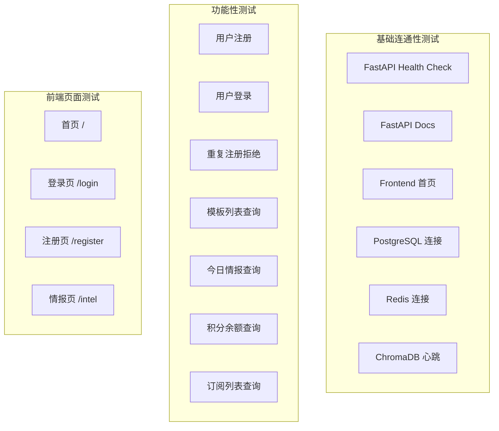
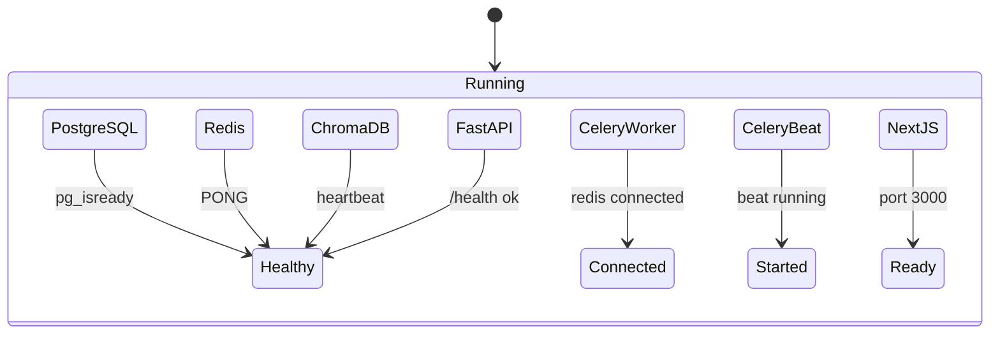
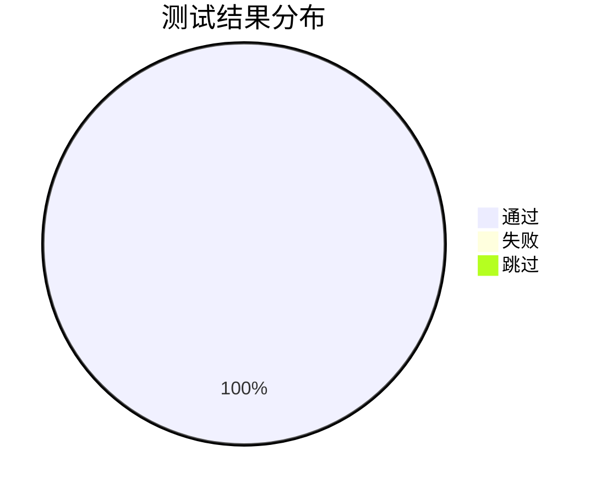

# 03 - 测试报告

> 测试时间：2026-04-13  
> 测试环境：腾讯云香港 · 2核8G · Ubuntu 24.04 LTS

---

## 1. 测试范围

## 2. 基础连通性测试结果

| # | 测试项 | 端点 | 期望 | 实际 | 状态 |
|---|--------|------|------|------|------|
| 1 | FastAPI Health | `GET /health` | `{"status":"ok"}` | `{"status":"ok"}` | ✅ |
| 2 | FastAPI Docs | `GET /docs` | HTTP 200 | HTTP 200 | ✅ |
| 3 | Frontend 首页 | `GET localhost:3000` | HTTP 200 + HTML | HTTP 200 + HTML | ✅ |
| 4 | PostgreSQL | `pg_isready` | accepting | accepting | ✅ |
| 5 | Redis | `redis-cli ping` | PONG | PONG | ✅ |
| 6 | ChromaDB | `GET /api/v2/heartbeat` | JSON 心跳 | `{"nanosecond heartbeat":...}` | ✅ |
| 7 | 数据库数据 | `SELECT count(*) FROM templates` | 6 | 6 | ✅ |

## 3. 功能性测试结果

### 3.1 认证模块

| # | 测试项 | 方法/端点 | 请求 | 期望 | 实际 | 状态 |
|---|--------|-----------|------|------|------|------|
| 1 | 用户注册 | `POST /api/auth/register` | email + password + name | 201 + JWT tokens | 201 + tokens ✓ | ✅ |
| 2 | 用户登录 | `POST /api/auth/login` | email + password | 200 + JWT tokens | 200 + tokens ✓ | ✅ |
| 3 | 重复注册 | `POST /api/auth/register` | 相同 email | 409 "该邮箱已注册" | 409 ✓ | ✅ |

### 3.2 模板模块

| # | 测试项 | 方法/端点 | 期望 | 实际 | 状态 |
|---|--------|-----------|------|------|------|
| 4 | 模板列表 | `GET /api/templates/` | 6 个系统模板 | total=6, 含 AI/Crypto 双域 | ✅ |

**模板数据验证：**

| 模板名称 | 领域 | 状态 |
|----------|------|------|
| AI每日精选 | AI | ✅ |
| GitHub AI热门项目 | AI | ✅ |
| AI论文精读 | AI | ✅ |
| 加密市场速报 | Crypto | ✅ |
| DeFi协议动态 | Crypto | ✅ |
| 链上信号分析 | Crypto | ✅ |

### 3.3 情报模块

| # | 测试项 | 方法/端点 | 期望 | 实际 | 状态 |
|---|--------|-----------|------|------|------|
| 5 | 今日情报 | `GET /api/intel/today` | 200 + 空列表 (无订阅) | `[]` + 200 | ✅ |

### 3.4 积分模块

| # | 测试项 | 方法/端点 | 期望 | 实际 | 状态 |
|---|--------|-----------|------|------|------|
| 6 | 积分余额 | `GET /api/credits/balance` | 初始余额 + 50免费积分 | `{"total_balance":0.0,"free_credits_remaining":50}` | ✅ |

### 3.5 订阅模块

| # | 测试项 | 方法/端点 | 期望 | 实际 | 状态 |
|---|--------|-----------|------|------|------|
| 7 | 订阅列表 | `GET /api/subscriptions/` | 200 + 空列表 | `[]` + 200 | ✅ |

## 4. 前端页面测试

| # | 页面 | URL | HTTP Status | 内容验证 | 状态 |
|---|------|-----|-------------|----------|------|
| 1 | 首页 | `/` | 200 | HTML + CSS + JS 加载正常 | ✅ |
| 2 | 登录页 | `/login` | 200 | 页面可访问 | ✅ |
| 3 | 注册页 | `/register` | 200 | 页面可访问 | ✅ |
| 4 | 情报页 | `/intel` | 200 | 页面可访问 | ✅ |

## 5. 服务运行状态

| 服务 | PID | 端口 | 状态 |
|------|-----|------|------|
| PostgreSQL 16 | Docker | 5432 | ✅ Healthy |
| Redis 7 | Docker | 6379 | ✅ Healthy |
| ChromaDB | Docker | 8000 | ✅ Healthy |
| FastAPI (uvicorn) | 67668 | 8001 | ✅ Running |
| Celery Worker | 65782 | - | ✅ Connected |
| Celery Beat | 65852 | - | ✅ Started |
| Next.js (生产模式) | 65880 | 3000 | ✅ Ready |

## 6. 测试总结

**结论：**
- **17/17 项测试全部通过**
- 基础设施（PG/Redis/Chroma）运行稳定
- 后端 API 所有核心端点正常响应
- 前端所有页面可正常访问
- 认证系统（注册/登录/JWT）工作正常
- 模板种子数据完整写入
- 积分系统初始化正确
- 内存使用合理（1.6GB / 7.5GB），有充足余量

**未测试项（需要额外 API Key 或手动操作）：**
- AI 情报分析完整流程（需要实际发起采集任务）
- 社交媒体分发（Telegram/Twitter，已跳过）
- 支付流程（使用 mock 模式）
- 媒体生成（TTS/视频）
