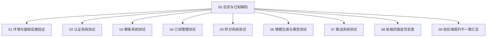
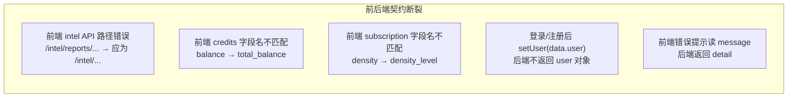
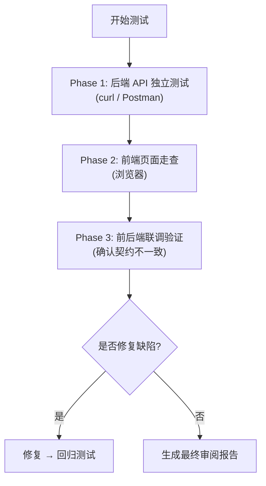

# 00 - 测试总览与已知缺陷清单

> 审阅人：项目负责人  
> 编写时间：2026-04-13  
> 目的：在正式修复之前，系统性梳理「当前代码实际能做什么」与「设计意图之间的 gap」

---

## 1. 测试手册结构

## 2. 测试优先级矩阵

| 优先级 | 模块 | 理由 |
|--------|------|------|
| **P0 - 阻断** | 认证系统 | 所有功能的入口，必须完全可用 |
| **P0 - 阻断** | 前后端 API 契约 | 前端大量路径/字段与后端不一致，直接导致功能不可用 |
| **P1 - 核心** | 模板系统 | 公共 API + 用户操作入口 |
| **P1 - 核心** | 订阅管理 | 用户核心操作路径 |
| **P1 - 核心** | 积分系统 | 涉及金钱，必须准确 |
| **P2 - 重要** | 情报生成 | 核心业务价值，但当前管线未完成闭环 |
| **P2 - 重要** | 推送系统 | stub 实现，仅验证逻辑框架 |
| **P3 - 辅助** | 前端 UI/UX | 视觉与交互体验 |

## 3. 已知缺陷清单（代码审计发现）

> 以下缺陷在本次代码审计中发现，**尚未修复**。测试时应逐一验证。

### 3.1 阻断级缺陷（功能完全不可用）

| ID | 严重性 | 模块 | 描述 | 影响 |
|----|--------|------|------|------|
| **BUG-001** | 阻断 | Auth→前端 | 登录/注册成功后 `setUser(data.user)`，但后端 `TokenResponse` 不含 `user` 字段 → `user` 始终为 `null` | 设置页等依赖 `user` 的页面无法显示用户信息 |
| **BUG-002** | 阻断 | Intel→前端 | `intelAPI` 使用 `/intel/reports/...` 路径，后端实际为 `/intel/today`、`/intel/list`、`/intel/{id}` | 情报页所有请求 404 |
| **BUG-003** | 阻断 | Intel→前端 | 情报页期望 `data.reports` 包装，后端直接返回数组 | 前端解构失败，页面空白 |
| **BUG-004** | 阻断 | Credits→前端 | 余额字段名 `balance`/`freeRemaining` ≠ 后端 `total_balance`/`free_credits_remaining` | 积分显示为 NaN 或 undefined |
| **BUG-005** | 阻断 | Credits→前端 | 充值 tier 传字符串 (`basic`/`standard`/`pro`)，后端期望整数 (`10`/`30`/`100`) | 充值请求 422 |
| **BUG-006** | 阻断 | Credits→前端 | 记录列表读 `data.records`/`data.earnings`，后端返回 `{ items, total, page, size }` | 列表为空 |
| **BUG-007** | 阻断 | Subscription→前端 | 表单字段名全面不匹配（`density`→`density_level`、`pushTime`→`push_time_bucket`、`brief`→`quick_scan`、`breaking`→`major_only` 等） | 创建订阅 400/422 |
| **BUG-008** | 阻断 | Template→前端 | 模板列表页 `data` 直接当数组用，后端返回 `{ items, total, page, size }` | 模板页空白或报错 |

### 3.2 严重级缺陷（核心逻辑错误）

| ID | 严重性 | 模块 | 描述 | 影响 |
|----|--------|------|------|------|
| **BUG-009** | 严重 | 情报生成 | 仓库中不存在「生成报告→写入 IntelReport 表→扣费→embedding」的完整实现 | 订阅后无法产出报告 |
| **BUG-010** | 严重 | 重新生成 | `regenerate_report` 不调用 AI，仅复制原报告字段；`feedback_text` 参数被忽略 | 用户反馈无效，报告不变 |
| **BUG-011** | 严重 | 脚本 | `scripts/run_daily.py` 引用 `Orchestrator` 类，但 `orchestrator.py` 只导出函数 → `ImportError` | 定时任务脚本无法运行 |
| **BUG-012** | 严重 | 订阅更新 | `update_subscription` 用 `setattr` 直接赋值，不校验枚举 | 可写入非法 domain/density 等值 |
| **BUG-013** | 严重 | 推送 | `channels = sub.formats`（`text/audio/video`）与 `PushService._send` 的频道名（`web/email/telegram/wechat`）不匹配 → 所有推送标记为 `failed` | 推送全部失败 |

### 3.3 中等级缺陷（数据/体验问题）

| ID | 严重性 | 模块 | 描述 |
|----|--------|------|------|
| **BUG-014** | 中等 | 前端文案 | 首页写「每日赠送100免费积分」，后端配置为 50 |
| **BUG-015** | 中等 | 重新生成 | `RegenDialog` 显示预计消耗 50 积分，后端实际扣 10 |
| **BUG-016** | 中等 | 前端错误处理 | 登录/注册错误提示读 `err.response.data.message`，后端返回 `detail` → 用户看到 "undefined" |
| **BUG-017** | 中等 | 领域映射 | 订阅 `domain` 大写 `AI`/`Crypto`，采集管线期望小写 `ai`/`crypto` |
| **BUG-018** | 中等 | Lineage | 后端返回扁平祖先链，前端 `LineageTree` 组件期望树形结构 |
| **BUG-019** | 中等 | 推送状态 | `get_push_status` 依赖 `sent_at` 非空，pending/failed 且未发送的日志不会出现 |
| **BUG-020** | 中等 | Auth | 后端 `password` 字段无长度/复杂度校验（前端有 min=8 但可绕过） |

## 4. 测试执行建议

**建议**：
1. **先用 curl/Postman 测后端 API**（绕过前端不一致问题），确认后端逻辑正确性
2. **再用浏览器走查前端**，逐页记录实际表现与预期差异
3. 两者结合后可精确定位「后端bug」vs「前端bug」vs「契约不一致」
