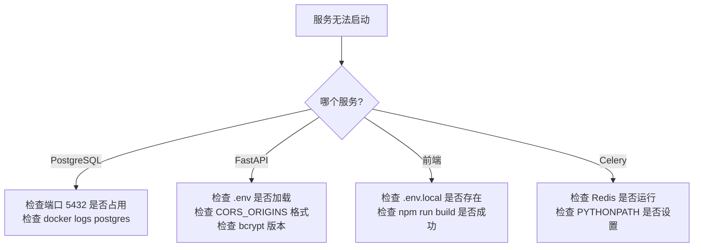

# 01 - 环境与基础设施验证

> 测试前提：项目已按部署文档完成安装并启动

---

## 1. 检查项清单

### 1.1 Docker 容器健康

| # | 测试步骤 | 预期结果 | 实际结果 | Pass/Fail |
|---|----------|----------|----------|-----------|
| 1 | `sudo docker compose ps` | 3个容器均为 `Up` 状态 | | |
| 2 | `sudo docker compose exec postgres pg_isready` | `accepting connections` | | |
| 3 | `sudo docker compose exec redis redis-cli ping` | `PONG` | | |
| 4 | `curl http://localhost:8000/api/v2/heartbeat` | JSON 含 `nanosecond heartbeat` | | |

### 1.2 应用服务健康

| # | 测试步骤 | 预期结果 | 实际结果 | Pass/Fail |
|---|----------|----------|----------|-----------|
| 5 | `curl http://localhost:8001/health` | `{"status":"ok"}` | | |
| 6 | `curl http://localhost:8001/docs` | HTTP 200，Swagger UI HTML | | |
| 7 | `curl http://localhost:3000` | HTTP 200，HTML 含 `lang="zh-CN"` | | |
| 8 | 检查 Celery Worker 日志 | 含 `celery@xxx ready` | | |
| 9 | 检查 Celery Beat 日志 | 含 `beat: Starting...` | | |

### 1.3 数据库数据完整性

| # | 测试步骤 | 预期结果 | 实际结果 | Pass/Fail |
|---|----------|----------|----------|-----------|
| 10 | `psql -d intel_engine -c "SELECT count(*) FROM templates"` | `6` | | |
| 11 | `psql -d intel_engine -c "SELECT name, domain FROM templates ORDER BY name"` | 6 条记录，AI 域 3 条、Crypto 域 3 条 | | |
| 12 | `psql -d intel_engine -c "\\dt"` | 至少含 users, templates, subscriptions, intel_reports, token_records, push_logs 等表 | | |

### 1.4 资源监控

| # | 测试步骤 | 预期结果 | 实际结果 | Pass/Fail |
|---|----------|----------|----------|-----------|
| 13 | `free -h` | 已用 < 4GB，可用 > 3GB | | |
| 14 | `df -h /` | 已用 < 40GB | | |
| 15 | 8001 端口无冲突 | `lsof -i :8001` 仅 uvicorn | | |

### 1.5 网络连通性

| # | 测试步骤 | 预期结果 | 实际结果 | Pass/Fail |
|---|----------|----------|----------|-----------|
| 16 | `curl -s https://api.deepseek.com/v1/models -H "Authorization: Bearer sk-ebe..."` | 200 + 模型列表 | | |
| 17 | `curl -s https://openrouter.ai/api/v1/models -H "Authorization: Bearer sk-or-..."` | 200 + 模型列表 | | |

---

## 2. 常见故障排查

