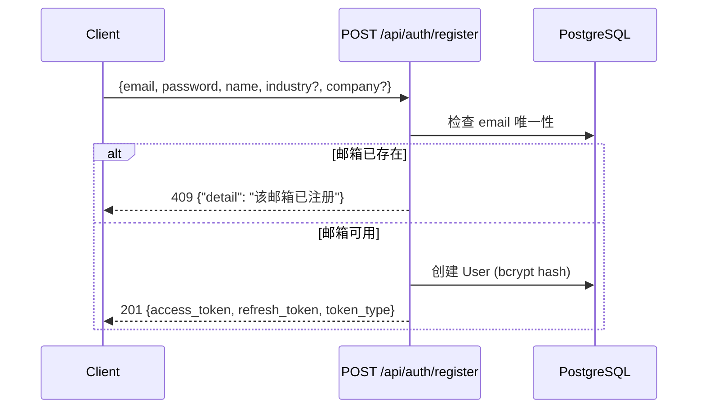

# 02 - 认证系统测试

> 测试工具：curl（后端独立）+ 浏览器（前端联调）

---

## 1. 后端 API 测试用例

### 1.1 用户注册

| # | 用例 | curl 命令 | 预期 | 实际 | P/F |
|---|------|-----------|------|------|-----|
| 1 | 正常注册 | `curl -X POST http://localhost:8001/api/auth/register -H "Content-Type: application/json" -d '{"email":"reviewer@test.com","password":"Abc12345","name":"审阅员"}'` | 201 + 双 token | | |
| 2 | 重复邮箱 | 同上再执行一次 | 409 `"该邮箱已注册"` | | |
| 3 | 缺少必填字段 | `-d '{"email":"a@b.com"}'` | 422 验证错误 | | |
| 4 | 无效邮箱格式 | `-d '{"email":"not-email","password":"123","name":"x"}'` | 422 | | |
| 5 | 空密码 | `-d '{"email":"e@f.com","password":"","name":"x"}'` | **观察实际行为**（后端无长度校验）→ 记录为 BUG-020 | | |
| 6 | 超长密码(100字符) | 100 字符密码 | **应成功**（bcrypt 截断 72 字节，不报错） | | |
| 7 | 含可选字段 | 增加 `"industry":"AI","company":"Test"` | 201 + 数据落库 | | |

### 1.2 用户登录

| # | 用例 | curl 命令 | 预期 | 实际 | P/F |
|---|------|-----------|------|------|-----|
| 8 | 正确凭据 | `curl -X POST http://localhost:8001/api/auth/login -H "Content-Type: application/json" -d '{"email":"reviewer@test.com","password":"Abc12345"}'` | 200 + 双 token | | |
| 9 | 错误密码 | `password` 改为 `wrong` | 401 `"邮箱或密码错误"` | | |
| 10 | 不存在的邮箱 | `email` 改为 `none@x.com` | 401 `"邮箱或密码错误"` | | |

### 1.3 Token 刷新

| # | 用例 | curl 命令 | 预期 | 实际 | P/F |
|---|------|-----------|------|------|-----|
| 11 | 有效 refresh_token | `curl -X POST http://localhost:8001/api/auth/refresh -H "Content-Type: application/json" -d '{"refresh_token":"<从登录获取>"}'` | 200 + 新双 token | | |
| 12 | 用 access_token 当 refresh | 把 access_token 传入 | 401 `"无效的刷新令牌"` | | |
| 13 | 过期 token | 手动构造过期 JWT | 401 `"刷新令牌已过期或无效"` | | |
| 14 | 胡乱字符串 | `"refresh_token":"garbage"` | 401 | | |

### 1.4 鉴权保护验证

| # | 用例 | 预期 | 实际 | P/F |
|---|------|------|------|-----|
| 15 | 无 Authorization 头访问 `/api/intel/today` | 401 | | |
| 16 | 带正确 Bearer token 访问 | 200 | | |
| 17 | 带过期 access_token 访问 | 401 | | |

---

## 2. 前端联调测试

| # | 操作 | 预期 | 已知问题 | P/F |
|---|------|------|----------|-----|
| 18 | 打开 `/register`，填表注册 | 注册成功，跳转 | **BUG-001**: `setUser(data.user)` → user 为 null | |
| 19 | 打开 `/login`，输入凭据登录 | 登录成功，跳转 | **BUG-001** 同上 | |
| 20 | 注册成功后检查 localStorage | 应有 `access_token` 和 `refresh_token` | | |
| 21 | 登录失败时的错误提示 | 应显示"邮箱或密码错误" | **BUG-016**: 读 `message` 而非 `detail` → 显示 undefined | |
| 22 | 重复注册时的错误提示 | 应显示"该邮箱已注册" | **BUG-016** 同上 | |
