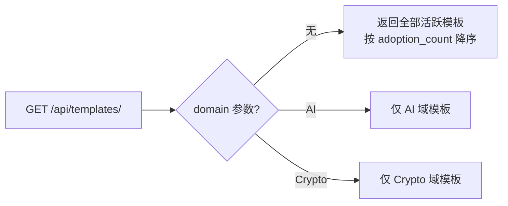

# 03 - 模板系统测试

> 模板是公共资源，列表和详情接口**不需要鉴权**；试用/采用/分叉需要登录

---

## 1. 后端 API 测试用例

### 1.1 模板列表

| # | 用例 | curl 命令 | 预期 | 实际 | P/F |
|---|------|-----------|------|------|-----|
| 1 | 获取全部模板 | `curl -s http://localhost:8001/api/templates/` | `{"items":[...6条], "total":6, "page":1, "size":20}` | | |
| 2 | 按域筛选 AI | `curl -s 'http://localhost:8001/api/templates/?domain=AI'` | 3 条 AI 模板 | | |
| 3 | 按域筛选 Crypto | `?domain=Crypto` | 3 条 Crypto 模板 | | |
| 4 | 不存在的域 | `?domain=Finance` | `{"items":[], "total":0, ...}` | | |
| 5 | 分页 page=1, size=2 | `?page=1&size=2` | 2 条，total=6 | | |
| 6 | 超出范围的页码 | `?page=100` | `{"items":[], "total":6, ...}` | | |

### 1.2 模板详情

| # | 用例 | curl 命令 | 预期 | 实际 | P/F |
|---|------|-----------|------|------|-----|
| 7 | 获取有效模板详情 | `curl -s http://localhost:8001/api/templates/<id>` | 含 `prompt_config`、`contributors`（空数组） | | |
| 8 | 不存在的 UUID | `/api/templates/00000000-0000-0000-0000-000000000000` | 404 | | |
| 9 | 非法 UUID 格式 | `/api/templates/not-a-uuid` | 422 | | |

### 1.3 模板谱系（Lineage）

| # | 用例 | 预期 | 实际 | P/F |
|---|------|------|------|-----|
| 10 | 无父模板的系统模板 | `[{"id":"...","name":"...","creator_type":"system","depth":0}]` | | |
| 11 | Fork 后查子模板谱系 | 应含父子两层 | | |

### 1.4 需登录的操作

> 以下测试需先获取 access_token，设为 `$TOKEN`

| # | 用例 | curl 命令 | 预期 | 实际 | P/F |
|---|------|-----------|------|------|-----|
| 12 | 试用模板 | `curl -X POST http://localhost:8001/api/templates/<id>/try -H "Authorization: Bearer $TOKEN"` | 200 含 ok/message | | |
| 13 | 重复试用 | 再次执行 | 409 | | |
| 14 | 采用模板 | `curl -X POST .../adopt -H "Authorization: Bearer $TOKEN"` | 200 `{"ok":true}` | | |
| 15 | 检查 adoption_count | 重新 GET 详情 | `adoption_count` +1 | | |
| 16 | Fork 模板 | `curl -X POST .../fork -H "Authorization: Bearer $TOKEN" -H "Content-Type: application/json" -d '{"name":"我的自定义模板","description":"测试fork"}'` | 200 新模板 | | |
| 17 | Fork 后查原模板 lineage | 原模板不变（lineage 只向上查） | | |
| 18 | Fork 后查新模板 lineage | 含父模板节点 | | |

---

## 2. 前端联调测试

| # | 操作 | 预期 | 已知问题 | P/F |
|---|------|------|----------|-----|
| 19 | 打开 `/cocreate` | 显示 6 个模板卡片 | **BUG-008**: 前端把响应直接当数组，后端返回 `{items,...}` → 可能空白 | |
| 20 | 点击模板卡片进详情 | 显示名称/描述/配置/谱系 | **BUG-018**: lineage 树组件期望树形结构 | |
| 21 | 点击"试用"按钮 | 调用 try API | 注意：服务层**不会实际生成报告**，仅记录试用 | |
| 22 | 搜索功能 | 关键词过滤模板 | 搜索可能是纯前端过滤 | |
| 23 | 领域筛选 | 切换 AI/Crypto | 验证是否传 `domain` 参数 | |
