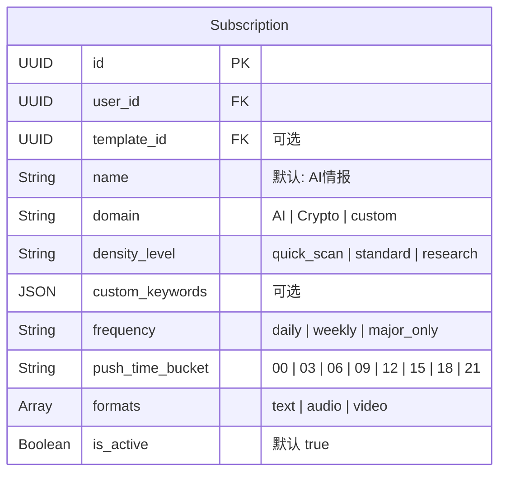

# 04 - 订阅管理测试

> 所有接口均需 Bearer Token 鉴权

---

## 1. 订阅数据模型



## 2. 后端 API 测试用例

### 2.1 创建订阅

| # | 用例 | 请求体 | 预期 | 实际 | P/F |
|---|------|--------|------|------|-----|
| 1 | 最简创建（全默认） | `{}` | 201，name="AI情报", domain 需验证默认值 | | |
| 2 | 完整字段创建 | `{"name":"我的AI订阅","domain":"AI","density_level":"standard","frequency":"daily","push_time_bucket":"09","formats":["text"]}` | 201 | | |
| 3 | Crypto 域 | `{"domain":"Crypto","name":"加密货币"}` | 201 | | |
| 4 | custom 域 | `{"domain":"custom","name":"自定义"}` | 201 | | |
| 5 | 非法 domain | `{"domain":"Finance"}` | 400 | | |
| 6 | 非法 density_level | `{"density_level":"ultra"}` | 400 | | |
| 7 | 非法 frequency | `{"frequency":"hourly"}` | 400 | | |
| 8 | 非法 push_time_bucket | `{"push_time_bucket":"07"}` | 400 | | |
| 9 | 关联模板 ID | `{"template_id":"<某模板UUID>"}` | 201，`template_id` 写入 | | |

**边界测试：**

| # | 用例 | 预期 | 实际 | P/F |
|---|------|------|------|-----|
| 10 | 创建第 51 条订阅 | 400 "达到订阅数量上限" | | |

### 2.2 查询订阅

| # | 用例 | 预期 | 实际 | P/F |
|---|------|------|------|-----|
| 11 | 获取用户全部订阅 `GET /api/subscriptions/` | 数组，含上面创建的记录 | | |
| 12 | 获取单条 `GET /api/subscriptions/<id>` | 完整订阅对象 | | |
| 13 | 获取不存在的 ID | 404 `"订阅不存在"` | | |
| 14 | 获取别人的订阅 | 404（按 user_id 过滤） | | |

### 2.3 更新订阅

| # | 用例 | 预期 | 已知问题 | P/F |
|---|------|------|----------|-----|
| 15 | 更新 name | 200，name 已变更 | | |
| 16 | 更新 density_level 为非法值 | **应 400，但实际可能 200** | **BUG-012**: 更新时不校验枚举 | |
| 17 | 更新 domain 为非法值 | 同上 | BUG-012 | |

### 2.4 切换激活 & 删除

| # | 用例 | 预期 | 实际 | P/F |
|---|------|------|------|-----|
| 18 | PATCH toggle | `is_active` 翻转 | | |
| 19 | 再次 toggle | 恢复原值 | | |
| 20 | DELETE 订阅 | 204，再 GET 返回 404 | | |

---

## 3. 前端联调测试

```mermaid
flowchart LR
    A[/subscriptions] -->|列表| B[SubCard 卡片]
    B -->|点击| C[/subscriptions/id/edit]
    A -->|新建| D[/subscriptions/new]
    D --> E[SubForm 表单]
    C --> E
```

| # | 操作 | 预期 | 已知问题 | P/F |
|---|------|------|----------|-----|
| 21 | 打开 `/subscriptions` | 显示订阅列表 | 可能有 camelCase/snake_case 不匹配 | |
| 22 | 点击新建，填写表单 | 跳转到 SubForm | | |
| 23 | 提交新建 | **预期失败** | **BUG-007**: 字段名全面不匹配 | |
| 24 | 切换开关 | 调 toggle API | 验证 `is_active` 变化 | |
| 25 | 编辑已有订阅 | 加载 → 修改 → 提交 | BUG-007 同样影响 | |
| 26 | 删除订阅 | 确认框 → 删除 | | |

### 前端字段映射问题详表（BUG-007）

| 前端字段 | 后端字段 | 说明 |
|----------|----------|------|
| `density` | `density_level` | 字段名不同 |
| `"brief"` | `"quick_scan"` | 枚举值不同 |
| `"breaking"` | `"major_only"` | 枚举值不同 |
| `pushTime` ("09:00") | `push_time_bucket` ("09") | 字段名 + 格式不同 |
| `customKeywords` | `custom_keywords` | camelCase vs snake_case |
| `templateId` | `template_id` | camelCase vs snake_case |
