# 06 - 情报生成与报告测试

> **核心业务模块**，也是当前代码完成度最低的模块

---

## 1. 设计 vs 现实

```mermaid
flowchart TB
    subgraph 设计意图["设计意图（完整管线）"]
        A[用户创建订阅] --> B[定时任务触发]
        B --> C[Orchestrator 调用 LangGraph]
        C --> D[数据采集<br/>RSS/GitHub/arXiv]
        D --> E[AI 质量评估]
        E --> F[AI 摘要生成]
        F --> G[行动建议生成]
        G --> H[写入 IntelReport 表]
        H --> I[向量化存入 ChromaDB]
        I --> J[推送给用户]
    end

    subgraph 当前现实["代码现实"]
        A2[用户创建订阅 ✅] --> B2[定时任务<br/>⚠️ 脚本有 ImportError]
        B2 -.->|断裂| C2[Orchestrator<br/>⚠️ 函数 vs 类不匹配]
        C2 -.->|断裂| H2[写入 IntelReport<br/>❌ 完全缺失]
        H2 -.->|断裂| J2[推送<br/>⚠️ 假设报告已存在]
    end

    style H2 fill:#ff6b6b,color:white
    style B2 fill:#feca57,color:black
    style C2 fill:#feca57,color:black
```



## 2. 可测试的 API 端点

> 虽然完整管线未闭环，以下 API 本身的逻辑可以测试

### 2.1 今日情报

| # | 用例 | curl 命令 | 预期 | 实际 | P/F |
|---|------|-----------|------|------|-----|
| 1 | 无报告时查今日 | `curl -s http://localhost:8001/api/intel/today -H "Authorization: Bearer $TOKEN"` | `[]` 空数组 | | |

### 2.2 报告列表

| # | 用例 | curl 命令 | 预期 | 实际 | P/F |
|---|------|-----------|------|------|-----|
| 2 | 无报告时查列表 | `GET /api/intel/list` | `{"items":[], "total":0, ...}` | | |
| 3 | 带筛选参数 | `?domain=AI&date_from=2026-04-01` | 正常返回（空） | | |

### 2.3 报告详情

| # | 用例 | 预期 | 实际 | P/F |
|---|------|------|------|-----|
| 4 | 不存在的报告 ID | 404 `"报告不存在"` | | |

### 2.4 重新生成（Regenerate）

> 需要先有报告才能测试，可通过直接插入测试数据

| # | 用例 | 预期 | 已知问题 | P/F |
|---|------|------|----------|-----|
| 5 | 重新生成存在的报告 | 200 + 新报告 | **BUG-010**: 不调 AI，仅复制 | |
| 6 | 同一报告重新生成第 4 次 | 429 | | |
| 7 | 积分不足时重新生成 | 402 | | |
| 8 | 带 feedback_text | 200 但 **feedback 被忽略** | BUG-010 | |

### 2.5 条目反馈

| # | 用例 | 预期 | 实际 | P/F |
|---|------|------|------|-----|
| 9 | 标记条目为重要 | 200 `{"ok":true}` | | |
| 10 | 切换回非重要 | 200 | | |

---

## 3. 前端联调测试

| # | 操作 | 预期 | 已知问题 | P/F |
|---|------|------|----------|-----|
| 11 | 打开 `/intel` | 显示今日情报 | **BUG-002**: API 路径错误 404 | |
| 12 | | | **BUG-003**: 期望 `data.reports` 包装 | |
| 13 | 点击报告详情 | 跳转报告页 | API 路径同样错误 | |
| 14 | 点击重要标记 | 切换标记状态 | 前端仅改本地 state，**未调后端 API** | |
| 15 | 打开重新生成对话框 | 显示反馈表单 | **BUG-015**: 显示消耗 50 实际扣 10 | |

---

## 4. 手动创建测试报告数据（辅助测试）

如果需要测试报告相关功能，可直接插入测试数据：

```sql
-- 在 PostgreSQL 中执行
INSERT INTO intel_reports (
    id, user_id, subscription_id, template_id,
    domain, title, items, density_level, 
    formats_generated, is_regenerated
) VALUES (
    gen_random_uuid(),
    '<你的用户UUID>',
    '<你的订阅UUID>',
    '<某模板UUID>',
    'AI',
    '测试报告 - AI每日精选',
    '[{"title":"GPT-5发布","summary":"测试摘要","importance_score":9.5}]'::json,
    'standard',
    '["text"]'::json,
    false
);
```

插入后即可测试 today/list/detail/regenerate/feedback 等完整功能链。

---

## 5. 审计重点

- [ ] **BUG-009 确认**：搜索代码库，确认是否存在「生成→落库」的实现路径
- [ ] **regenerate 是否应该重跑 AI**：确认产品意图
- [ ] **feedback_text 应传到哪里**：是否应传给 LLM 做再生参考
- [ ] **Orchestrator 管线能否独立运行**：直接调用 `generate_report()` 看结果
