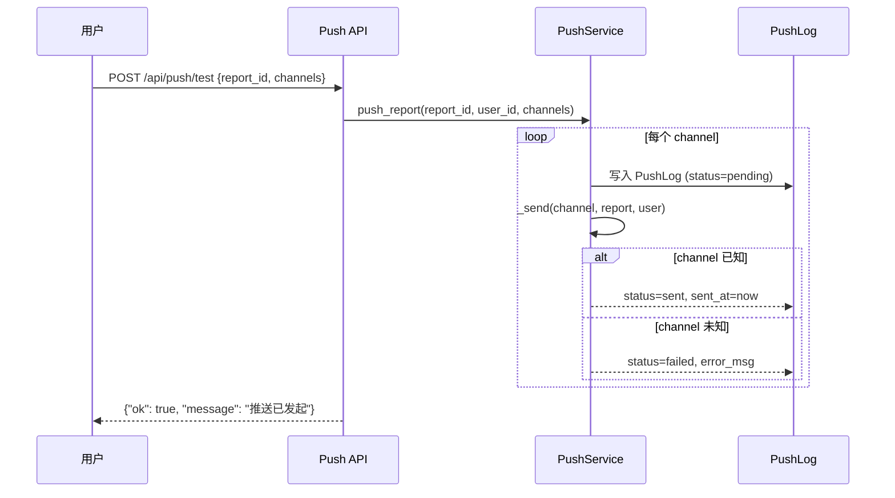
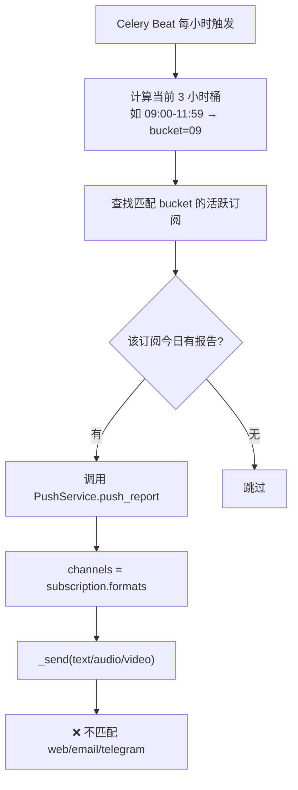

# 07 - 推送系统测试

> 所有发送通道当前为 **stub 实现**（空函数），仅验证逻辑框架

---

## 1. 推送流程

## 2. 后端 API 测试用例

### 2.1 推送状态查询

| # | 用例 | curl 命令 | 预期 | 实际 | P/F |
|---|------|-----------|------|------|-----|
| 1 | 无推送记录 | `curl -s http://localhost:8001/api/push/status -H "Authorization: Bearer $TOKEN"` | `[]` | | |

### 2.2 测试推送

> 需要先有报告（可用上一章的 SQL 插入）

| # | 用例 | 请求体 | 预期 | 已知问题 | P/F |
|---|------|--------|------|----------|-----|
| 2 | 推送到 web | `{"report_id":"<id>","channels":["web"]}` | 200 `{"ok":true,...}` | 实际 `_send` 为空操作 | |
| 3 | 推送到 email | `channels:["email"]` | 同上 | stub | |
| 4 | 推送到 telegram | `channels:["telegram"]` | 同上 | stub，且未配置 bot token | |
| 5 | 推送到未知渠道 | `channels:["sms"]` | 应该 PushLog 标记为 `failed` | | |
| 6 | 多渠道同时推送 | `channels:["web","email"]` | 2 条 PushLog | | |
| 7 | 不存在的 report_id | 随机 UUID | 验证是否有校验 | | |

### 2.3 推送后查询状态

| # | 用例 | 预期 | 已知问题 | P/F |
|---|------|------|----------|-----|
| 8 | 查询状态 | 应显示刚才的推送记录 | **BUG-019**: 仅返回 `sent_at` 非空的记录；pending/failed 可能不显示 | |

---

## 3. Celery 定时推送（`daily_push`）

| # | 验证项 | 预期 | 已知问题 | P/F |
|---|--------|------|----------|-----|
| 9 | Celery Beat 日志中看到调度 | `Scheduler: Sending due task...` | | |
| 10 | Worker 执行推送任务 | 看日志 `run_hourly_push` | 如无报告则直接跳过 | |
| 11 | channels 来源 | `sub.formats = ["text"]` | **BUG-013**: 与 `_send` 的频道名不匹配 | |

---

## 4. 审计重点

- [ ] `formats` 字段的双重语义：既是「报告输出格式」又被当作「推送渠道」
- [ ] `get_push_status` 是否应该也返回 `sent_at IS NULL` 的记录
- [ ] 失败的推送是否有重试机制（当前无）
