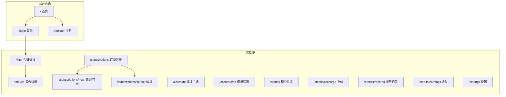

# 08 - 前端页面逐页走查

> 工具：浏览器（Chrome DevTools Network/Console 面板打开）  
> 前提：服务已启动，已有注册用户

---

## 1. 页面清单与路由

## 2. 逐页检查表

### 2.1 首页 `/`

| # | 检查项 | 预期 | 已知问题 | P/F |
|---|--------|------|----------|-----|
| 1 | 页面加载 | 200, 功能介绍/步骤/定价展示 | | |
| 2 | 导航链接 | 登录/注册/模板广场链接可点击 | | |
| 3 | 免费积分文案 | 与后端一致 | **BUG-014**: 首页写 100，后端为 50 | |
| 4 | 定价展示 | 三个档位正确 | | |
| 5 | 响应式布局 | 手机尺寸不破版 | | |

### 2.2 注册页 `/register`

| # | 检查项 | 预期 | 已知问题 | P/F |
|---|--------|------|----------|-----|
| 6 | 表单字段 | 姓名、邮箱、密码（min 8）、行业/公司可选 | | |
| 7 | 前端校验 | 密码少于 8 位时提示 | | |
| 8 | 提交成功 | token 存入 localStorage，跳转 | **BUG-001**: user 为 null | |
| 9 | 错误提示 | 显示后端错误信息 | **BUG-016**: 读 message 而非 detail | |
| 10 | 已登录时访问 | 是否重定向 | | |

### 2.3 登录页 `/login`

| # | 检查项 | 预期 | 已知问题 | P/F |
|---|--------|------|----------|-----|
| 11 | 表单字段 | 邮箱、密码 | | |
| 12 | 提交成功 | token 存入，跳转 | BUG-001 | |
| 13 | 错误提示 | 显示后端错误 | BUG-016 | |
| 14 | 注册链接 | 可点击跳转 | | |

### 2.4 情报页 `/intel`

| # | 检查项 | 预期 | 已知问题 | P/F |
|---|--------|------|----------|-----|
| 15 | 页面加载 | 调 API 获取今日情报 | **BUG-002**: 路径错误 → 404 | |
| 16 | 空状态 | 优雅的空状态提示 | **BUG-003**: 解构 `data.reports` 失败 | |
| 17 | Network 面板 | 确认实际请求路径 | 记录实际 URL | |
| 18 | Console 面板 | 有无 JS 错误 | 预计有错误 | |

### 2.5 报告详情 `/intel/:id`

| # | 检查项 | 预期 | 已知问题 | P/F |
|---|--------|------|----------|-----|
| 19 | 页面加载 | 获取报告详情 | 路径错误 | |
| 20 | 返回按钮 | 回到列表 | | |

### 2.6 订阅列表 `/subscriptions`

| # | 检查项 | 预期 | 已知问题 | P/F |
|---|--------|------|----------|-----|
| 21 | 页面加载 | 显示订阅卡片 | camelCase/snake_case | |
| 22 | 开关切换 | 调 toggle API | | |
| 23 | 新建按钮 | 跳转 /new | | |
| 24 | 点击卡片 | 跳转编辑页 | | |

### 2.7 新建订阅 `/subscriptions/new`

| # | 检查项 | 预期 | 已知问题 | P/F |
|---|--------|------|----------|-----|
| 25 | 表单渲染 | 领域/密度/频率/时间/格式选择 | | |
| 26 | 提交 | Network 中看请求体 | **BUG-007**: 字段名完全不匹配 | |
| 27 | 提交结果 | 大概率 400/422 | | |

### 2.8 编辑订阅 `/subscriptions/:id/edit`

| # | 检查项 | 预期 | 已知问题 | P/F |
|---|--------|------|----------|-----|
| 28 | 数据回填 | 现有值正确填入表单 | snake_case 字段可能无法回填 | |
| 29 | 删除按钮 | 确认框 → 删除 | | |

### 2.9 模板广场 `/cocreate`

| # | 检查项 | 预期 | 已知问题 | P/F |
|---|--------|------|----------|-----|
| 30 | 模板列表 | 6 个模板卡片 | **BUG-008**: 响应结构不匹配 | |
| 31 | 搜索 | 过滤功能 | | |
| 32 | 领域筛选 | AI/Crypto 切换 | | |

### 2.10 模板详情 `/cocreate/:id`

| # | 检查项 | 预期 | 已知问题 | P/F |
|---|--------|------|----------|-----|
| 33 | 基本信息 | 名称/描述/域 | | |
| 34 | 配置展示 | prompt_config 内容 | 前端可能期望不同字段名 | |
| 35 | 谱系树 | 渲染祖先链 | **BUG-018**: 数据结构不匹配 | |
| 36 | 试用按钮 | 调 try API | 不实际生成报告 | |
| 37 | Fork 弹窗 | 填名称+描述 → 创建 | | |

### 2.11 积分总览 `/credits`

| # | 检查项 | 预期 | 已知问题 | P/F |
|---|--------|------|----------|-----|
| 38 | 余额显示 | 正确数字 | **BUG-004**: 字段名不匹配 | |
| 39 | 消费记录 | 列表 | **BUG-006**: 读 `data.records` | |

### 2.12 充值页 `/credits/recharge`

| # | 检查项 | 预期 | 已知问题 | P/F |
|---|--------|------|----------|-----|
| 40 | 档位选择 | 3 个档位卡片 | | |
| 41 | 支付方式 | 选择框 | | |
| 42 | 提交充值 | 调 recharge API | **BUG-005**: tier 类型错误 | |

### 2.13 消费记录 `/credits/records`

| # | 检查项 | 预期 | 已知问题 | P/F |
|---|--------|------|----------|-----|
| 43 | 列表渲染 | 消费/充值记录 | **BUG-006** | |
| 44 | 分页 | 翻页功能 | query 参数 `limit` vs 后端 `size` | |

### 2.14 收益页 `/credits/earnings`

| # | 检查项 | 预期 | 已知问题 | P/F |
|---|--------|------|----------|-----|
| 45 | 列表渲染 | 创作者收益 | **BUG-006** + 当前无此类记录 | |

### 2.15 设置页 `/settings`

| # | 检查项 | 预期 | 已知问题 | P/F |
|---|--------|------|----------|-----|
| 46 | 用户信息展示 | 姓名/邮箱/行业/公司 | **BUG-001**: user 为 null → 空白 | |
| 47 | 保存按钮 | 保存用户设置 | 纯占位实现（setTimeout） | |
| 48 | 通知开关 | 切换通知设置 | 纯前端，无 API | |

---

## 3. 通用检查项（每个页面都要验证）

| # | 检查项 | 说明 |
|---|--------|------|
| A | 未登录访问 | 是否重定向到 /login |
| B | Token 过期 | 是否触发自动 refresh |
| C | Console 错误 | 打开 DevTools 记录所有 JS 错误 |
| D | Network 请求 | 记录所有 API 调用的 URL、状态码、响应体 |
| E | 移动端适配 | Chrome DevTools 切换手机视图 |
| F | 加载状态 | 是否有 loading 提示 |
| G | 空状态 | 无数据时是否有友好提示 |
