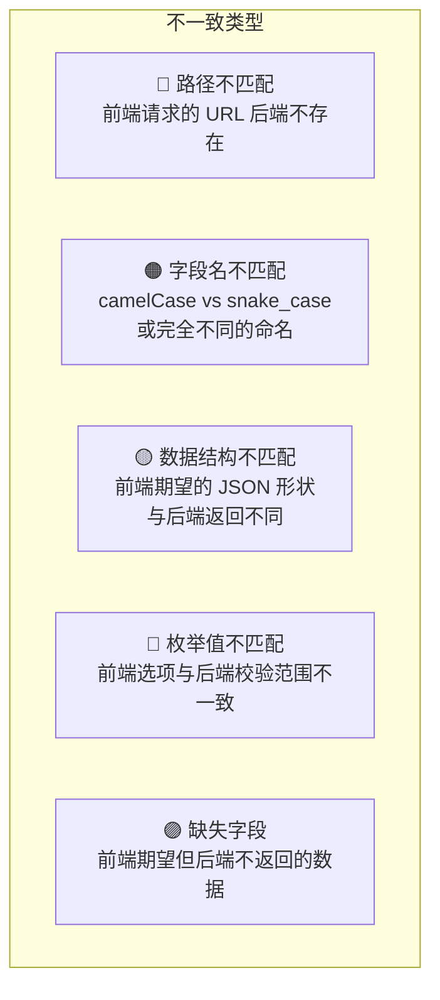
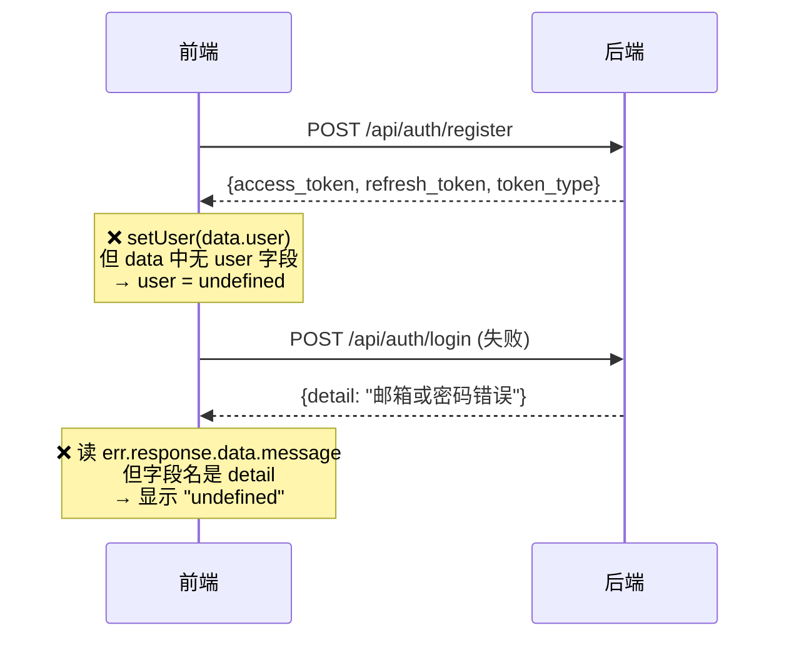
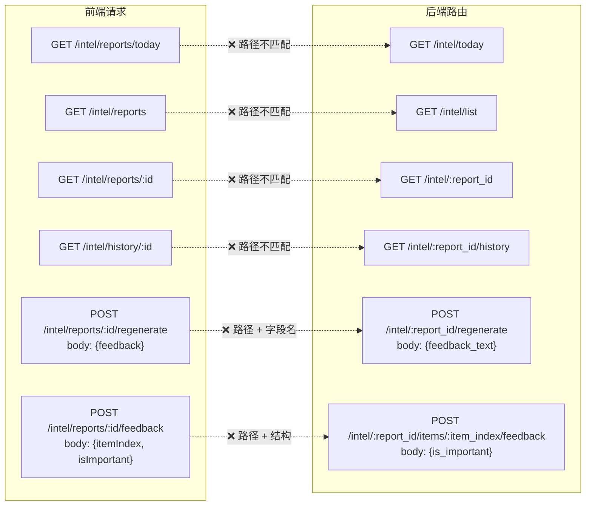
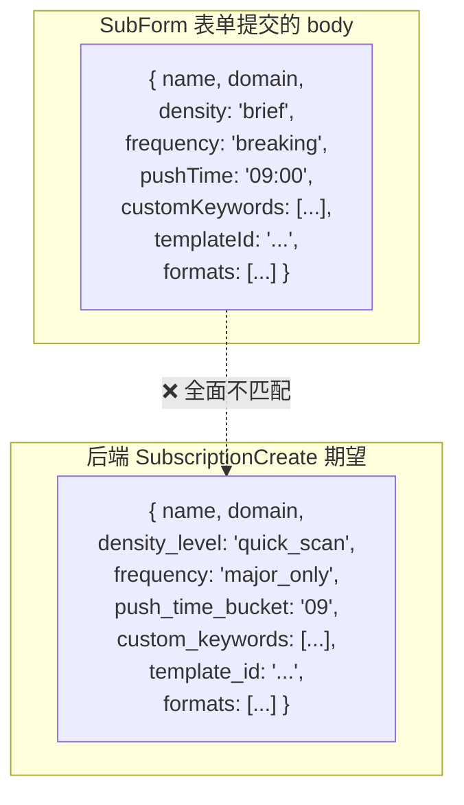
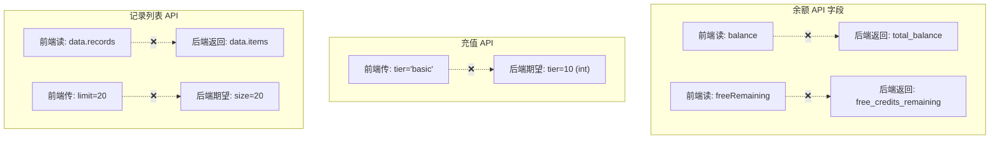

# 09 - 前后端契约不一致汇总

> 本文档是整个测试手册的**核心产出**。  
> 所有不一致项均通过源码审计发现，需要逐一验证并决定修复方向。

---

## 1. 不一致全景图

## 2. 按模块逐项列举

### 2.1 认证模块 (Auth)

| ID | 类型 | 前端代码位置 | 前端期望 | 后端实际 | 修复建议 |
|----|------|-------------|----------|----------|----------|
| **C-001** | 🟣 缺失字段 | `login/page.tsx` `register/page.tsx` | `data.user` 含用户详情 | `TokenResponse` 仅含 token，无 `user` | 后端在注册/登录响应中加入 `user` 对象；或前端登录后额外调 `/api/auth/me` |
| **C-002** | 🟠 字段名 | `login/page.tsx` catch | `err.response.data.message` | FastAPI 返回 `detail` | 前端改为读 `err.response?.data?.detail` |

---

### 2.2 情报模块 (Intel)

| ID | 类型 | 前端代码 | 前端请求 | 后端实际 | 修复建议 |
|----|------|---------|----------|----------|----------|
| **C-003** | 🔴 路径 | `api.ts` intelAPI | `GET /intel/reports/today` | `GET /intel/today` | 前端去掉 `/reports` |
| **C-004** | 🔴 路径 | `api.ts` intelAPI | `GET /intel/reports` | `GET /intel/list` | 前端改路径 |
| **C-005** | 🔴 路径 | `api.ts` intelAPI | `GET /intel/reports/:id` | `GET /intel/:id` | 前端去掉 `/reports` |
| **C-006** | 🔴 路径 | `api.ts` intelAPI | `GET /intel/history/:id` | `GET /intel/:id/history` | 前端改为 `:id/history` |
| **C-007** | 🟠 字段名 | `api.ts` regenerate | body: `{ feedback }` | body: `{ feedback_text }` | 前端改字段名 |
| **C-008** | 🔴 路径 + 结构 | `api.ts` feedback | `POST /intel/reports/:id/feedback` body含 `itemIndex` | `POST /intel/:id/items/:item_index/feedback` body含 `is_important` | 前端改路径结构，item_index 改到 URL 参数 |
| **C-009** | 🟡 结构 | `intel/page.tsx` | 期望 `data.reports`（包装对象） | 直接返回 `ReportResponse[]`（数组） | 前端改为直接用 `data` |
| **C-010** | 🟠 字段名 | `intel/page.tsx` toggleImportant | 仅改本地 state | 应调后端 feedback API | 前端补充 API 调用 |

---

### 2.3 模板模块 (Templates / Cocreate)

| ID | 类型 | 前端代码 | 前端期望 | 后端实际 | 修复建议 |
|----|------|---------|----------|----------|----------|
| **C-011** | 🟡 结构 | `cocreate/page.tsx` | `data` 直接当模板数组遍历 | `{ items: [...], total, page, size }` | 前端改为读 `data.items` |
| **C-012** | 🟡 结构 | `cocreate/[id]/page.tsx` | `template.config` | 后端返回 `prompt_config` | 前端改字段名 |
| **C-013** | 🟡 结构 | `cocreate/[id]/page.tsx` LineageTree | 期望树形 `{ node, children: [...] }` | 后端返回扁平列表 `[{id, name, depth}, ...]` | 前端做 list→tree 转换；或后端改为返回树形 |

---

### 2.4 订阅模块 (Subscriptions)

| ID | 类型 | 前端值 | 后端值 | 修复建议 |
|----|------|--------|--------|----------|
| **C-014** | 🟠 字段名 | `density` | `density_level` | 统一命名 |
| **C-015** | 🔵 枚举值 | `"brief"` | `"quick_scan"` | 统一枚举 |
| **C-016** | 🔵 枚举值 | `"breaking"` | `"major_only"` | 统一枚举 |
| **C-017** | 🟠 字段名 + 格式 | `pushTime: "09:00"` | `push_time_bucket: "09"` | 统一命名和格式 |
| **C-018** | 🟠 字段名 | `customKeywords` | `custom_keywords` | camelCase → snake_case |
| **C-019** | 🟠 字段名 | `templateId` | `template_id` | camelCase → snake_case |

---

### 2.5 积分模块 (Credits)

| ID | 类型 | 前端代码 | 前端请求/期望 | 后端实际 | 修复建议 |
|----|------|---------|-------------|----------|----------|
| **C-020** | 🟠 字段名 | `store.ts` fetchUser | 读 `data.balance` | 返回 `total_balance` | 对齐字段名 |
| **C-021** | 🟠 字段名 | `store.ts` fetchUser | 读 `data.freeRemaining` | 返回 `free_credits_remaining` | 对齐字段名 |
| **C-022** | 🔵 类型 | `recharge/page.tsx` | `tier: "basic"/"standard"/"pro"` | `tier: 10/30/100` (int) | 前端做映射 basic→10 等 |
| **C-023** | 🟡 结构 | `credits/page.tsx` `records/page.tsx` | 读 `data.records` | 返回 `{ items: [...] }` | 前端改为 `data.items` |
| **C-024** | 🟡 结构 | `earnings/page.tsx` | 读 `data.earnings` | 返回 `{ items: [...] }` | 前端改为 `data.items` |
| **C-025** | 🟠 参数名 | `api.ts` creditAPI | query: `limit=20` | query: `size=20` | 前端改参数名 |

---

### 2.6 推送模块 (Push)

| ID | 类型 | 位置 | 问题 | 影响 |
|----|------|------|------|------|
| **C-026** | 🔵 枚举 | `subscription_service` + `push_service` | `sub.formats`（`text/audio/video`）被当作 channel 传入 `push_report`，但 `_send` 只认 `web/email/telegram/wechat` | 所有定时推送均标记为 `failed` |

---

### 2.7 数据文案不一致

| ID | 位置 | 前端文案 | 后端/配置实际值 | 修复建议 |
|----|------|---------|----------------|----------|
| **C-027** | `app/page.tsx` 首页 | "每日赠送 100 免费积分" | `DAILY_FREE_CREDITS=50` | 统一为 50 或改配置 |
| **C-028** | `regen-dialog.tsx` | "预计消耗 50 积分" | `regenerate_report` 固定扣 10 | 统一数值 |

---

## 3. 修复优先级排序

```mermaid
gantt
    title 修复优先级建议
    dateFormat X
    axisFormat %s
    
    section P0 阻断（前端完全不能用）
    C-001 Auth 无 user 对象          :crit, 0, 2
    C-003~C-006 Intel 路径全错       :crit, 0, 3
    C-011 模板列表结构不匹配         :crit, 0, 1
    C-014~C-019 订阅字段名全不匹配   :crit, 0, 3
    C-020~C-025 积分字段/结构不匹配  :crit, 0, 3
    
    section P1 严重（功能异常）
    C-002 错误提示字段名             :active, 3, 4
    C-007~C-010 Intel 字段/行为      :active, 3, 5
    C-012~C-013 模板详情结构         :active, 3, 5
    C-022 充值 tier 类型             :active, 3, 4
    C-026 推送 channel 不匹配       :active, 3, 5
    
    section P2 中等（体验问题）
    C-027 免费积分文案不一致         :5, 6
    C-028 重新生成积分文案不一致     :5, 6
```

## 4. 修复方向建议

### 方案 A：修前端适配后端（推荐）

> 后端 API 设计合理，前端尚未联调，改前端成本较低

- **优点**：后端不动，减少回归风险
- **缺点**：前端改动量大（约 8 个文件）
- **工作量估计**：~4 小时

### 方案 B：修后端适配前端

> 把后端 API 改成前端期望的形状

- **优点**：前端代码不改
- **缺点**：后端改动面广，需要同时改路由、Schema、服务层
- **工作量估计**：~6 小时

### 方案 C：双向对齐（推荐大项目）

> 先定义 API 契约文档（OpenAPI spec），再双向修改

- **优点**：最规范，长期可维护
- **缺点**：耗时最长
- **工作量估计**：~8 小时

---

## 5. 验证清单（修复后回归测试）

修复完成后，逐项验证以下场景：

| # | 场景 | 验证方法 |
|---|------|----------|
| 1 | 注册后用户信息可显示 | 设置页显示姓名/邮箱 |
| 2 | 登录失败有中文提示 | 输错密码看提示文案 |
| 3 | 情报页能加载 | Network 无 404 |
| 4 | 模板广场显示 6 个卡片 | 页面可见卡片 |
| 5 | 创建订阅成功 | 提交后列表多一条 |
| 6 | 积分页显示正确数字 | 余额不是 NaN |
| 7 | 充值功能可用 | 提交不报 422 |
| 8 | 消费记录可见 | 列表有数据 |
| 9 | 推送不全部 failed | 至少 web channel 标记为 sent |
| 10 | 文案数值一致 | 首页积分数 = 配置值 |
