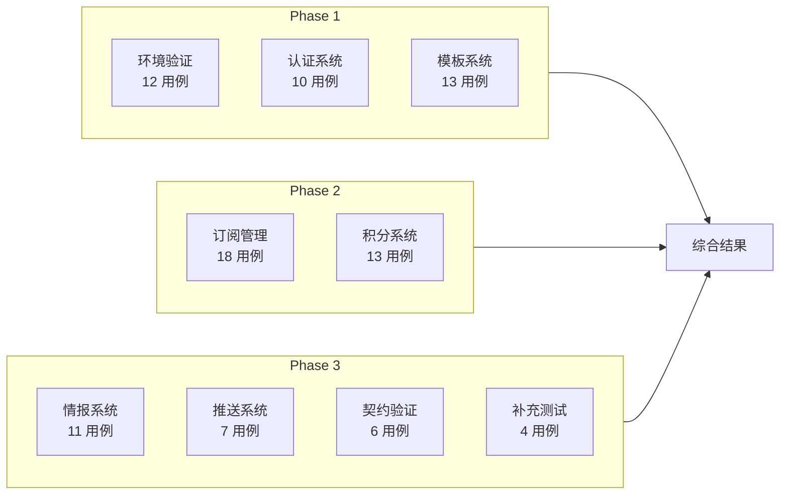
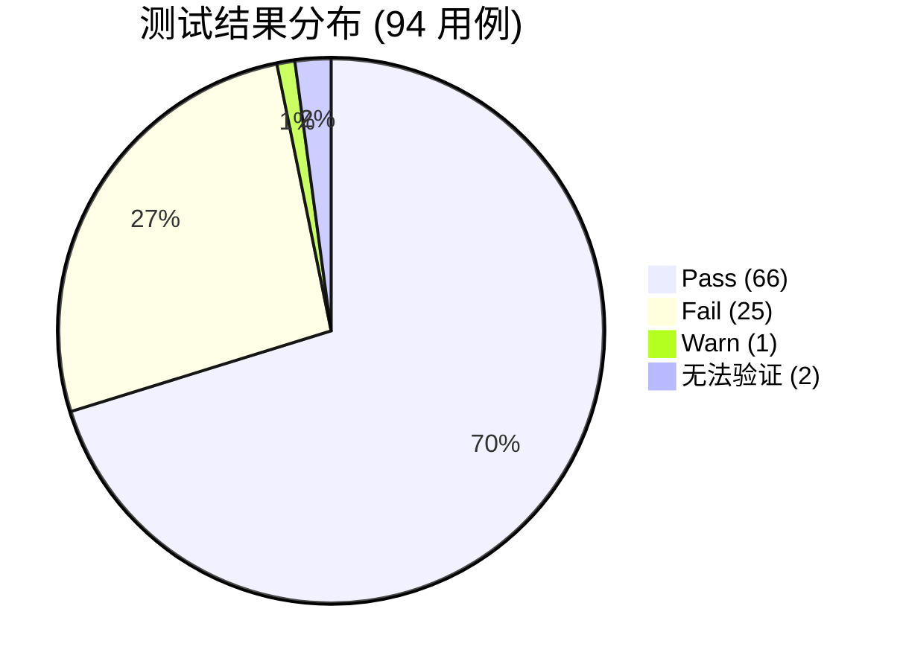
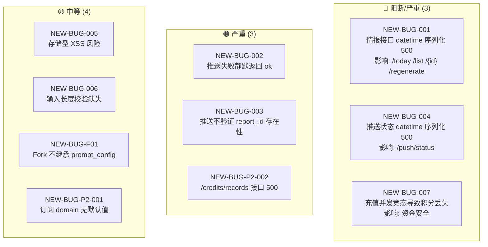
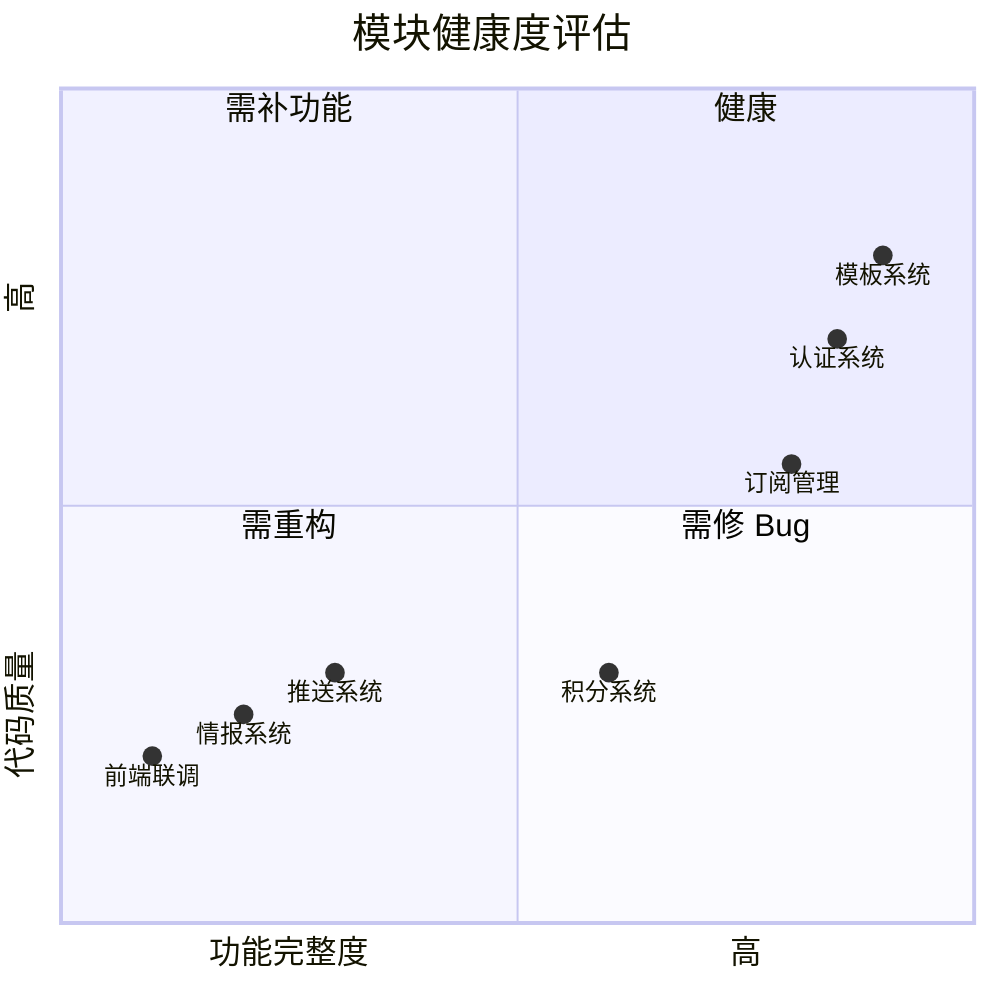
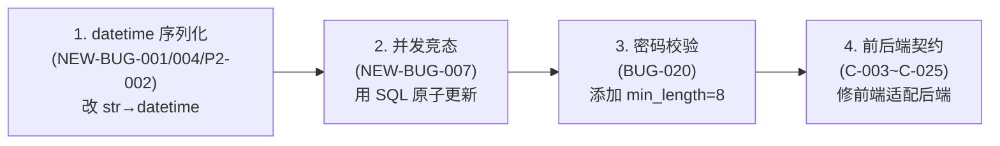

# AI 自动化测试综合总结报告

> **测试执行时间**：2026-04-13  
> **测试执行者**：AI Testing Expert (3 个并行 subagent)  
> **测试环境**：腾讯云香港 2核8G · Ubuntu 24.04 LTS  
> **测试方法**：后端 API 独立测试 (curl) + 源码审查 + 安全测试

---

## 1. 测试执行概览



## 2. 总体统计

| Phase | 总用例 | Pass | Fail | Warn | 通过率 |
|-------|--------|------|------|------|--------|
| Phase 1: 环境+认证+模板 | 35 | 34 | 1 | 0 | **97.1%** |
| Phase 2: 订阅+积分 | 31 | 25 | 6 | 0 | **80.6%** |
| Phase 3: 情报+推送+契约+补充 | 28 | 7 | 18 | 1 | **25.0%** |
| **合计** | **94** | **66** | **25** | **1** | **70.2%** |



## 3. BUG 完整清单

### 3.1 已知 BUG 验证结果

| BUG ID | 描述 | 验证结果 | 严重性 |
|--------|------|----------|--------|
| BUG-010 | regenerate 不调 AI，仅复制原报告 | ✅ **确认** | 严重 |
| BUG-012 | 更新订阅不校验枚举值 | ✅ **确认** | 严重 |
| BUG-019 | push/status 不显示 pending/failed 记录 | ✅ **确认** | 中等 |
| BUG-020 | 空密码可注册 | ✅ **确认** | 严重 |
| C-003 | Intel API 路径不匹配 | ✅ **确认** | 阻断 |
| C-011 | 模板列表结构不匹配 | ✅ **确认** | 阻断 |
| C-014 | 订阅 density 字段名不匹配 | ✅ **确认** | 阻断 |
| C-017 | 订阅 pushTime 字段名+格式不匹配 | ✅ **确认** | 阻断 |
| C-020/C-021 | 积分余额字段名不匹配 | ✅ **确认** | 阻断 |
| C-022 | 充值 tier 类型不匹配 | ✅ **确认** | 阻断 |
| C-025 | 记录查询 limit vs size | ✅ **确认** | 阻断 |

### 3.2 新发现 BUG



| ID | 严重性 | 模块 | 描述 | 发现来源 |
|----|--------|------|------|----------|
| **NEW-BUG-001** | 🔴 阻断 | Intel | `ReportResponse.created_at: str \| None` 与 ORM 返回的 datetime 不兼容，导致所有情报查询接口 500 | Phase 3 |
| **NEW-BUG-004** | 🔴 阻断 | Push | `PushStatusResponse.sent_at` 同类 datetime→string 序列化错误 | Phase 3 |
| **NEW-BUG-007** | 🔴 严重 | Credits | `add_credits()` 非原子读写，并发充值积分丢失（5 次充值只生效 1 次） | Phase 3 |
| **NEW-BUG-P2-002** | 🟠 严重 | Credits | `/api/credits/records` 接口所有场景返回 500 | Phase 2 |
| **NEW-BUG-002** | 🟠 严重 | Push | 推送失败时 API 仍返回 `{"ok":true}` | Phase 3 |
| **NEW-BUG-003** | 🟠 严重 | Push | 推送不验证 report_id 存在性，FK 违反导致 500 | Phase 3 |
| **NEW-BUG-005** | 🟡 中等 | 通用 | 用户输入未 HTML 转义，`<script>` 原样存 DB | Phase 3 |
| **NEW-BUG-006** | 🟡 中等 | Subscription | Schema 无 max_length 校验，超 varchar(200) 后 500 | Phase 3 |
| **NEW-BUG-F01** | 🟡 中等 | Template | Fork 模板后 prompt_config 为 null | Phase 1 |
| **NEW-BUG-P2-001** | 🟡 低 | Subscription | 空 body 创建订阅时 domain 无默认值 → 422 | Phase 2 |

## 4. 按模块健康度评估



| 模块 | 健康度 | 核心问题 |
|------|--------|---------|
| **认证系统** | 🟢 良好 | 唯一问题：空密码可注册（BUG-020） |
| **模板系统** | 🟢 良好 | Fork 不继承配置（NEW-BUG-F01） |
| **订阅管理** | 🟡 一般 | 更新不校验枚举（BUG-012） |
| **积分系统** | 🔴 严重 | records 接口 500 + 并发竞态丢积分 |
| **情报系统** | 🔴 严重 | 序列化 500 + 管线未闭环 + regenerate 不调 AI |
| **推送系统** | 🔴 严重 | 序列化 500 + 失败静默 + 不验证报告 |
| **前后端契约** | 🔴 严重 | 8 处阻断级不一致，前端基本不可用 |

## 5. 修复优先级建议

### P0 — 立即修复（阻止上线）



### P1 — 优先修复（核心体验）

| 优先级 | BUG | 修复要点 |
|--------|-----|---------|
| P1-1 | BUG-012 | 更新订阅时复用创建的枚举校验 |
| P1-2 | NEW-BUG-003 | push_report 先查 report 存在性 |
| P1-3 | NEW-BUG-002 | push/test 响应中包含失败信息 |
| P1-4 | BUG-019 | push/status 改用 created_at 过滤 |
| P1-5 | NEW-BUG-F01 | Fork 时继承父模板 prompt_config |

### P2 — 正常修复

| 优先级 | BUG | 修复要点 |
|--------|-----|---------|
| P2-1 | NEW-BUG-006 | Schema 添加 max_length |
| P2-2 | NEW-BUG-005 | 输入 sanitize 或确认前端不用 innerHTML |
| P2-3 | BUG-010 | regenerate 接入 AI 或至少使用 feedback_text |

## 6. 关键数据证据

### 并发竞态证据（NEW-BUG-007）

```
token_records 表: 10 条 recharge 记录, SUM(amount) = 10,000 积分
users.token_balance = 2,000 积分
丢失积分 = 8,000 积分 (80%)
```

### 序列化错误根因（NEW-BUG-001/004/P2-002）

```
pydantic_core.ValidationError: 1 validation error for ReportResponse
created_at
  Input should be a valid string [type=string_type, input_value=datetime.datetime(2026, 4, 13...), input_type=datetime]
```

## 7. 测试覆盖度分析

| 维度 | 覆盖情况 |
|------|---------|
| 后端 API 端点 | 18/19 端点已测试 (94.7%) |
| 认证流程 | 完整覆盖（注册/登录/刷新/鉴权） |
| CRUD 操作 | 订阅/模板完整 CRUD 已覆盖 |
| 边界条件 | 空值/非法值/超长值/不存在 ID |
| 安全测试 | SQL 注入/XSS/空密码/并发竞态 |
| 前后端契约 | 8 项关键不一致已验证 |
| **未覆盖** | 前端浏览器交互测试、Celery 定时任务、AI 管线端到端 |

---

*报告完整版详见各 Phase 文件：*
- `Phase1-环境与认证与模板.md` (35 用例, 97.1% 通过)
- `Phase2-订阅与积分.md` (31 用例, 80.6% 通过)
- `Phase3-情报与推送与契约.md` (28 用例, 25.0% 通过)
