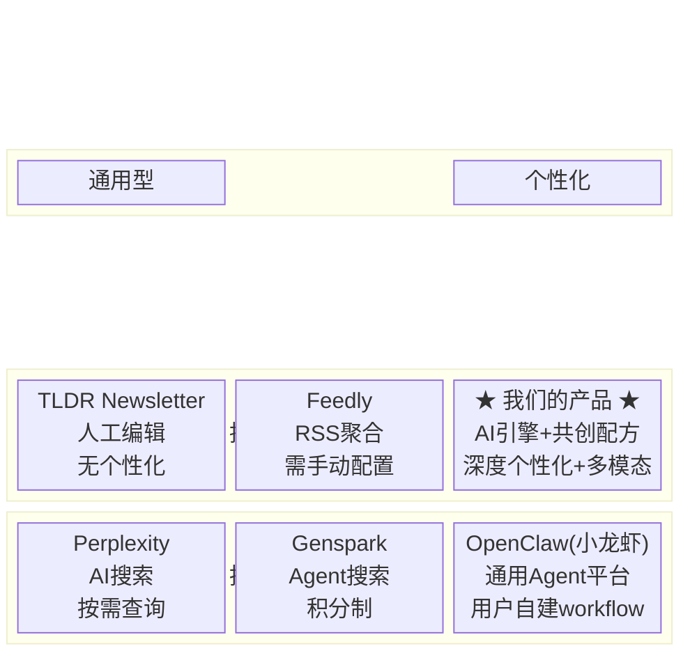
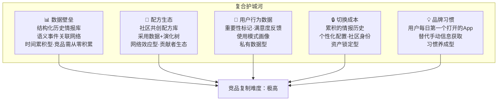
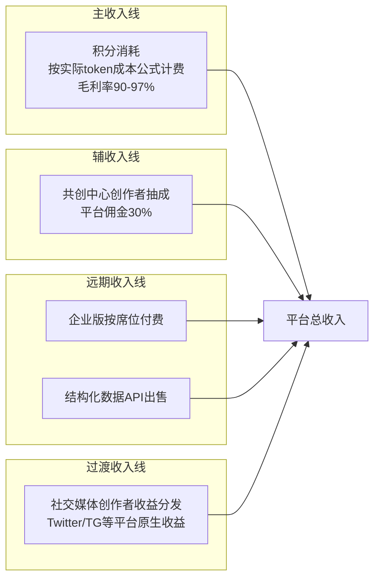

# 产品愿景与定位

**版本**: v2.0  
**日期**: 2026-04-10  
**状态**: 草案  
**前序版本**: [12-产品愿景与定位](../specs/12-产品愿景与定位.md)  
**关联文档**: [22-P0核心功能PRD](./22-P0核心功能PRD.md)

---

## 1. 电梯演讲（30秒版）

> 我们正在构建一个**个人化AI情报分析师平台**。用户创建订阅——关注什么领域、什么信息密度、什么格式——系统持续自动采集、交叉验证、趋势分析、历史关联，以文字/音频/视频三种形态将高价值情报推送到用户手中。区别于Genspark、Perplexity、OpenClaw等搜索型或通用Agent平台，我们做的是**信息找用户**——并通过社区共创的情报配方让分析质量持续进化。用户只需5分钟，便获得一位专业分析师花3小时才能完成的情报整理。

## 2. 核心问题

### 2.1 我们为谁解决什么问题？

**信息过载时代的注意力困境**：一个AI从业者每天需要扫描arXiv、GitHub Trending、HackerNews、Twitter KOL、行业报告等10+信息源才能保持对前沿的感知。一个加密货币投资者需要追踪链上数据、项目动态、KOL观点、监管新闻。这个过程每天消耗1-3小时，且80%信息是噪声。

**我们的解决方案**：用多智能体系统替用户完成 **采集 → 筛选 → 分析 → 历史关联 → 行动建议 → 推送** 的全流程，将每天1-3小时的信息获取压缩为5-10分钟的高密度阅读/收听/观看。

**关键定义**：本产品不是"每日新闻推送"——推送只是交付机制。核心价值是 **替用户执行专业分析师的工作**：多源采集、交叉验证、趋势识别、事件脉络追踪、行动建议输出。

> **理论基础**：
> - Christensen (1997)「Jobs to Be Done」——用户购买的不是"推送"，而是"用5分钟掌握我需要知道的一切"这个结果。
> - Simon (1971) 注意力经济学——信息丰富导致注意力贫乏，价值在于筛选而非生产。

### 2.2 为什么是现在？

| 时机因素 | 说明 |
|:---------|:-----|
| LLM成本暴跌 | DeepSeek V3：¥0.001/千input token，使"Agent为每个用户定制分析"在经济上可行 |
| Agent基础设施成熟 | LangGraph、MCP协议、LiteLLM在2026年已达生产级就绪状态 |
| 向量数据库普及 | Chroma/Pinecone使语义历史关联的开发成本极低 |
| AI市场爆发 | TLDR AI专刊125万订阅者——"AI情报"品类需求已被验证 |
| 中国市场空白 | 国内无"推送型AI情报引擎 + 共创配方 + 多模态"的直接竞品 |

## 3. 目标用户画像

### 3.1 核心用户（P0阶段）

**Persona A：AI从业者/学习者 — "小李"**

| 维度 | 描述 |
|:-----|:-----|
| 画像 | 25岁，AI初创公司工程师 / 在读研究生 / 独立开发者 |
| 日常痛点 | 每天花1-2h刷Twitter/arXiv/HN获取AI动态，80%是噪声 |
| 核心需求 | "每天给我最值得关注的AI进展，告诉我为什么重要，建议我下一步做什么" |
| 付费意愿 | 中等（¥30-50/月），对明确提升效率的工具愿付费 |
| 触达渠道 | Twitter、知乎、GitHub、即刻 |

**Persona B：加密货币投资者/研究者 — "老王"**

| 维度 | 描述 |
|:-----|:-----|
| 画像 | 28岁，加密货币交易者 / DeFi研究员 / Web3开发者 |
| 日常痛点 | 信息分散在Twitter、TG群、链上数据平台之间，错过关键信号 |
| 核心需求 | "自动追踪我关注的项目和链上数据，有异动给我分析，告诉我该关注什么" |
| 付费意愿 | 高（$10-50/月），信息差直接关联投资收益 |
| 触达渠道 | Telegram、Twitter、Discord |

### 3.2 扩展用户（P1+阶段，仅列出）

| Persona | 画像 | 核心需求 | 优先级 |
|:--------|:-----|:---------|:-------|
| C: 企业团队 | 某公司10人技术团队 | 团队共享行业情报 | P2 (PLG路径) |
| D: 配方创作者 | 领域专家/KOL | 用专业知识创建配方赚取分成 | P1 |
| E: 内容创作者 | 自媒体运营者 | 用情报引擎生成内容素材 | P2 |

## 4. 竞品定位

### 4.1 关键差异化矩阵

| 维度 | Genspark | OpenClaw | Perplexity | TLDR | **我们** |
|:-----|:---------|:---------|:-----------|:-----|:---------|
| 交互模式 | 用户搜索 | 用户配置Agent | 用户搜索 | 被动接收 | **主动推送+反馈学习** |
| 上手难度 | 低 | 高（需配置） | 低 | 无 | **极低（选领域即可）** |
| 内容质量驱动 | 通用LLM | 用户配置决定 | 通用LLM | 人工编辑 | **社区共创配方进化** |
| 历史关联 | 无 | 无 | 无 | 无 | **语义事件网络** |
| 多模态 | 文字为主 | 取决于配置 | 文字为主 | 文字 | **文字+音频+视频** |
| 社区生态 | 无 | Agent市场 | 无 | 无 | **共创中心（配方+分成）** |
| 反馈闭环 | 无 | 无 | 无 | 无 | **重要性标记+满意度反馈** |

**核心差异一句话**：OpenClaw让用户自己当厨师；我们给用户一个持续进化的专业厨师团队。

## 5. 护城河分析

### 5.1 "模型性能提升会打击我们吗？"

**不会，反而增强。** 模型性能提升 = 我们的情报质量提升 + 成本下降。我们的护城河不是模型能力（那是OpenAI/Anthropic/DeepSeek的事），而是 **数据 + 配方 + 社区 + 用户习惯**——这些护城河随时间增强，不受模型迭代影响。

更强的模型让我们能更精确地采集、筛选、分析、关联——这直接转化为用户体验提升。

## 6. 商业模式

### 6.1 收入结构

**关键设计**：社交媒体（Twitter/TG/国内平台）**不设付费订阅**，仅作推广渠道引流至SaaS平台。变现全部通过平台内积分消耗。

### 6.2 积分定价公式

$$
\text{credits\_consumed} = \left\lceil \frac{(\text{input\_tokens} \times P_{\text{in}} + \text{output\_tokens} \times P_{\text{out}}) \times M_{\text{platform}} \times M_{\text{density}}}{R_{\text{credit}}} \right\rceil
$$

| 参数 | 含义 | 参考值 |
|:-----|:-----|:-------|
| $P_{\text{in}}$ | 模型输入token单价 | DeepSeek V3: ¥0.001/千token |
| $P_{\text{out}}$ | 模型输出token单价 | DeepSeek V3: ¥0.002/千token |
| $M_{\text{platform}}$ | 平台溢价系数 | 15（确保90%+毛利率） |
| $M_{\text{density}}$ | 信息密度系数 | 速览=0.6, 标准=1.0, 研究级=2.0 |
| $R_{\text{credit}}$ | 积分兑人民币比率 | 1积分 = ¥0.01（¥10 = 1000积分） |

**设计原则**：

- 一次充值解锁所有功能，按实际消耗扣积分
- 不同报告成本不同（医学深度分析 >> 娱乐速览），对用户公平透明
- 免费日积分足够生成一次标准密度报告（约30-50积分）

### 6.3 单位经济学

| 指标 | 数值 | 说明 |
|:-----|:-----|:-----|
| 标准密度报告生成成本 | ¥0.02-0.08 | 智能路由加权（80% DeepSeek + 20% Claude） |
| 标准密度报告用户支付 | ≈30-50积分（¥0.30-0.50） | 公式计算结果 |
| **毛利率** | **90-97%** | 极高毛利SaaS模型 |
| 每日免费额度平台成本 | ¥0.02-0.08/用户 | 可承受的获客/留存成本 |
| 目标月ARPU（C端） | ¥30-100 | 参考Genspark $24.99/月 |

## 7. 产品原则

| 原则 | 含义 | 反面 |
|:-----|:-----|:-----|
| **质量至上** | 每份报告都以最高质量标准输出，用最好的模型做分析 | ~~用低价低质吸引用户~~ |
| **推送优先** | 用户创建订阅后系统自动工作，无需重复操作 | ~~每次手动搜索~~ |
| **配方驱动** | 情报质量由社区共创配方持续进化 | ~~质量取决于单一团队~~ |
| **按量公平** | 按实际token消耗计费，不同报告不同成本 | ~~一刀切月费~~ |
| **App即门户** | 成为用户每日接入世界信息的第一个入口 | ~~只是一个辅助工具~~ |
| **模块可插拔** | 架构支持快速增删功能模块，持续快速迭代 | ~~改一处动全身~~ |
| **Dog-fooding** | 创始人是第一个深度用户 | ~~自己不用自己的产品~~ |

## 8. 成功指标

### Phase 1-2（验证期，Week 1-6）

| 指标 | 目标 | 衡量方式 |
|:-----|:-----|:---------|
| 自用价值 | 创始人每日使用，替代手动信息获取 | 主观评估 |
| 社交媒体粉丝 | 500-2,000 | Twitter + TG + 国内平台合计 |
| 内容互动率 | 日均10+点赞/评论 | 社交媒体Analytics |

### Phase 3-4（增长期，Week 7-22）

| 指标 | 目标 | 衡量方式 |
|:-----|:-----|:---------|
| SaaS注册用户 | 200-500 | 产品数据库 |
| 付费转化率 | 5-10% | 付费用户 / 注册用户 |
| 月收入 | ¥5,000-20,000 | 实际入账 |
| 月留存率 | >40% | 次月活跃率 |

### Phase 5（规模期，Week 23-30）

| 指标 | 目标 | 衡量方式 |
|:-----|:-----|:---------|
| 月收入 | ¥20,000+ | 实际入账 |
| 活跃配方数 | 100+ | 被使用过的配方数量 |
| 企业客户 | 3-5家 | PLG自然转化 |

## 9. P1+功能路线图（仅列出，不展开设计）

| 功能 | 优先级 | 简述 |
|:-----|:-------|:-----|
| 报告皮肤/风格系统 | P1 | 默认简朴 + 付费华丽皮肤 + 用户创作皮肤获分成 |
| 角色扮演报告语气 | P1 | cosplay语气生成报告（消耗额外积分） |
| 用户自定义数据源 | P1 | 用户输入URL作为情报来源，系统自动爬取并验证 |
| 自定义精确推送时间 | P1 | 用户自选推送时间（消耗更多积分） |
| 徽章/VIP等级体系 | P1-P2 | 社区共创者/纠错专家等徽章 + VIP等级递进 |
| 用户纠错获积分 | P1 | 发现情报错误 → AI验证 → 奖励积分 |
| 社区一键订阅 | P2 | 看到他人分享的情报 → 一键复制为自己的订阅 |
| 公司圈/学校圈 | P3 | 查看同组织人员的热门关注 |
| 积分预测投票 | P2 | 纯积分投票，不可兑换法币 |
| 企业版 | P2-P3 | 团队管理 + 集中计费 + PLG up-sell |
| 结构化数据API | P2 | 对外出售情报数据接口 |
| 英文版SaaS | P2 | Stripe支付 + 英文UI + i18n |
| 事件网络可视化 | P2 | 星图式展示用户关注事件间的关联关系 |
| LoRA模型微调 | P3 | 中长期技术壁垒 |

## 10. 参考资料

1. **Christensen, C. (1997)** — The Innovator's Dilemma + Jobs to Be Done 理论框架
2. **Simon, H. (1971)** — "Designing Organizations for an Information-Rich World"，注意力经济学理论
3. **Thiel, P. (2014)** — Zero to One，从小市场统治再横向扩展的竞争策略
4. **Bartlett, B. (2019)** — Product-Led Growth 四阶段框架
5. **Genspark (2026)** — AI搜索+Agent工作空间，$24.99-249.99/月积分订阅制
6. **OpenClaw/小龙虾 (2026)** — 通用Agent平台，用户自建工作流
7. **TLDR Newsletter (2026)** — AI专刊125万+订阅者，约$5M/年收入
8. **PromptBase (2026)** — 提示词市场，平台抽成20%，50万+提示词
9. **Kahneman, D. & Tversky, A. (1979)** — Prospect Theory，支持免费试用模式的行为经济学基础

---

**本文档定义产品的"为什么"和"为谁"。具体"做什么"见 [22-P0核心功能PRD](./22-P0核心功能PRD.md)。**
