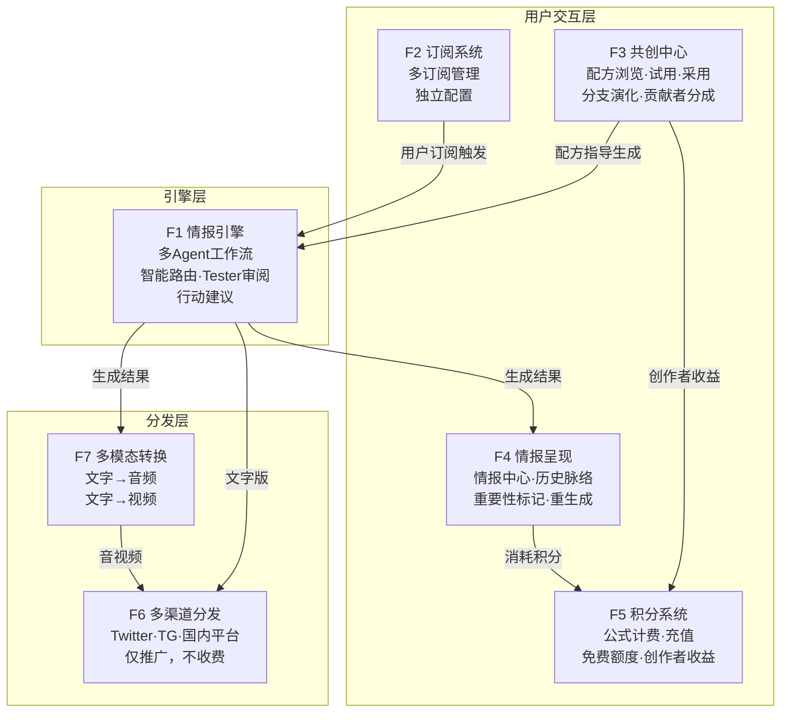
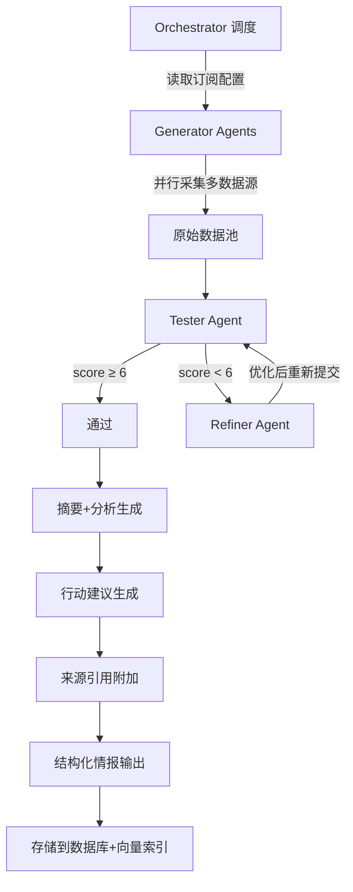
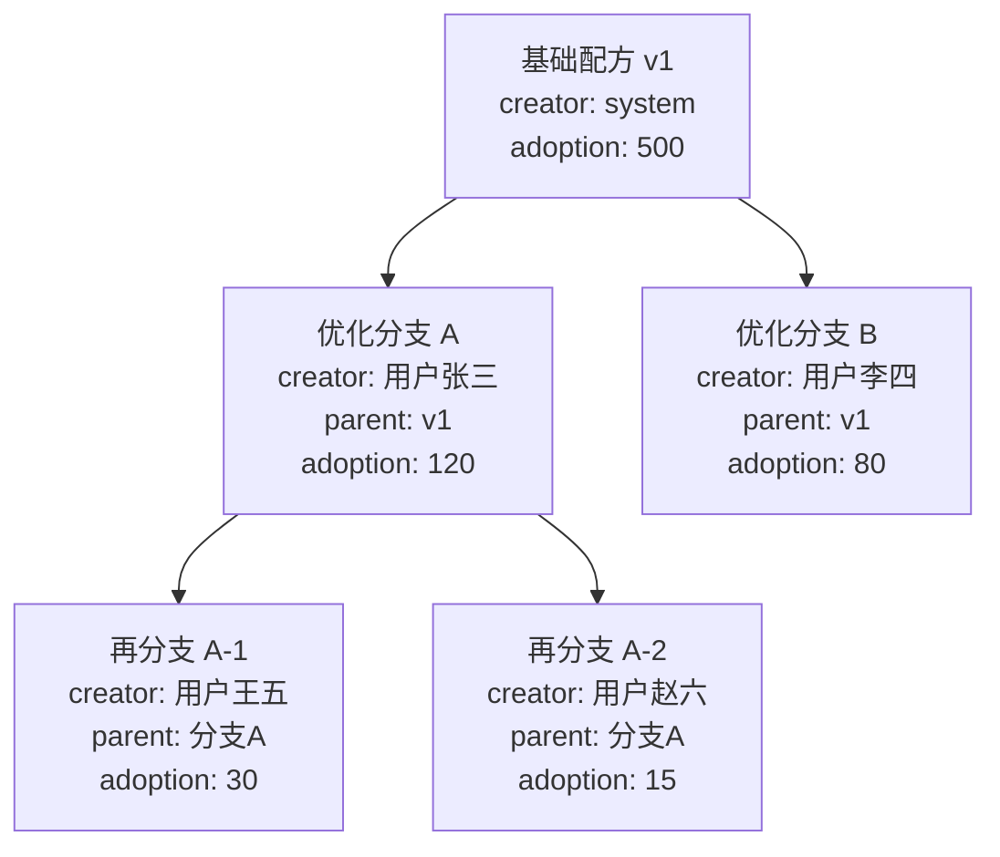

# P0 核心功能 PRD

**版本**: v2.0  
**日期**: 2026-04-10  
**状态**: 草案  
**范围**: P0（MVP必须）功能完整设计；P1+功能仅在末尾列清单  
**前序版本**: [13-P0核心功能PRD](../specs/13-P0核心功能PRD.md)  
**关联文档**: [21-产品愿景与定位](./21-产品愿景与定位.md) | [23-信息架构与数据模型](./23-信息架构与数据模型.md)

---

## 1. 功能总览

P0功能划分为 **7个功能域**，覆盖从引擎到呈现的完整链路：

### 页面结构

| 页面 | 路径 | 职责 | 关联功能域 |
|:-----|:-----|:-----|:----------|
| **情报中心** | `/intel` | 今日情报流展示、内联历史脉络展开、重要性标记、不满意重生成 | F4 |
| **订阅管理** | `/subscriptions` | 创建/编辑/删除订阅，每条订阅独立配置领域/密度/格式/频率/时间/配方 | F2 |
| **共创中心** | `/cocreate` | 浏览配方、免费试用、采用、分支创建、贡献者列表、采用排行榜 | F3 |
| **积分管理** | `/credits` | 余额查看、充值、消费记录、每日免费额度、创作者收益明细 | F5 |
| **账户设置** | `/settings` | 个人信息、通知偏好、安全设置 | — |

**设计原则**：每个页面职责单一且明确，页面间不交叉承担功能。

---

## 2. F1 — 情报引擎

### F1.1 多Agent情报采集-筛选-摘要工作流

**用户故事**  
作为创始人/用户，我希望系统自动从多个数据源采集信息、筛选出高价值内容、生成结构化分析摘要并附带行动建议，使我无需手动浏览10+信息源。

**功能描述**

- Orchestrator 根据订阅配置调度 Generator / Tester / Refiner
- Generator 从配置的数据源并行采集原始信息
- Tester 执行事实核查、去重、时效性检查、合规过滤、质量评分
- Refiner 对低于质量阈值（score < 6）的内容重新处理
- 输出结构化情报，包含来源引用和行动建议
- 所有输出同时写入向量数据库，供历史脉络语义检索

**验收标准**

- [ ] 给定AI领域配置，能从 ≥5 个数据源采集信息
- [ ] 给定Crypto领域配置，能从 ≥4 个数据源采集信息
- [ ] Tester 能过滤 >24h 的旧闻
- [ ] Tester 能去除与前一天重复的内容
- [ ] 输出包含：标题、摘要、重要性评分、原文链接、行动建议
- [ ] 单次全流程运行时间 < 5分钟
- [ ] 创始人审阅后主观评价"比手动搜集好"

### F1.2 双领域数据源配置

**用户故事**  
作为创始人，我希望同一引擎通过不同配置文件服务AI和Crypto两个领域，验证"引擎领域无关"的核心假设。

**功能描述**

- 每个领域一个YAML配置文件：数据源列表、采集参数、筛选标准、输出格式
- 新增领域 = 新增一个配置文件，无需改引擎代码
- 细分领域信息不足时，引擎自动融合用户订阅的相关领域信息，不强制每领域独立成报告

**数据源清单**

| 领域 | 数据源 | 类型 | 优先级 |
|:-----|:-------|:-----|:-------|
| AI | arXiv API | 论文 | P0 |
| AI | GitHub Trending | 开源项目 | P0 |
| AI | HackerNews API | 社区讨论 | P0 |
| AI | TechCrunch RSS | 行业新闻 | P0 |
| AI | ProductHunt API | 新产品 | P0 |
| AI | Google News RSS (AI关键词) | 综合新闻 | P0 |
| Crypto | CoinGecko API | 市场数据 | P0 |
| Crypto | DeFiLlama API | DeFi数据 | P0 |
| Crypto | Messari API | 项目研究 | P0 |
| Crypto | Etherscan API | 链上数据 | P0 |
| 通用 | Twitter/X 搜索 | KOL观点 | P1 |

**验收标准**

- [ ] AI领域配置独立运行并产出情报
- [ ] Crypto领域配置独立运行并产出情报
- [ ] 两个领域可并行运行，互不干扰
- [ ] 新增第三个领域仅需创建配置文件

### F1.3 智能路由

**用户故事**  
作为创始人，我希望系统自动将简单任务分配给低成本模型、复杂任务分配给高质量模型，在保证质量的前提下控制成本。

**功能描述**

- 通过 LiteLLM 统一调用接口
- 路由规则：数据采集/格式化 → DeepSeek V3；深度分析/摘要生成 → Claude Sonnet
- 路由决策记录到日志，用于后续成本审计

**验收标准**

- [ ] ≥80% 的任务使用 DeepSeek V3
- [ ] 单次全领域情报生成的API成本 < ¥0.50
- [ ] 路由决策日志可查，包含模型选择原因和token消耗

### F1.4 Tester Agent 自动审阅

**用户故事**  
作为创始人，我希望Tester Agent自动完成内容审阅和合规检查，使矩阵分发场景不依赖人工。

**功能描述**

- 事实核查：交叉验证关键声明（至少2个来源佐证）
- 去重：与历史24h内已推送内容比对（基于标题+摘要相似度）
- 时效性：过滤超过配置的 `max_age_hours` 的信息
- 合规过滤：中国内容合规敏感词检测，AI生成内容标识
- 质量评分：0-10分，低于6分退回Refiner

**验收标准**

- [ ] 检出并过滤 >24h 旧闻
- [ ] 检出重复内容（与前一天推送比对）
- [ ] 合规过滤捕捉基本敏感词
- [ ] 质量评分与创始人主观评价相关性 >60%

### F1.5 行动建议生成

**用户故事**  
作为用户，我希望每条情报不只是告诉我"发生了什么"，还告诉我"我应该做什么"——如果想深入了解应该阅读什么、关注什么、采取什么行动。

**功能描述**

- Agent 在生成情报摘要后，额外生成1-3条行动建议
- 行动建议类型：推荐阅读（附链接）、推荐关注（人/项目）、建议行动（技术决策/投资注意等）
- 行动建议附在每条情报项末尾

**验收标准**

- [ ] 每条情报项包含 ≥1 条行动建议
- [ ] 行动建议包含具体可执行的内容（非泛泛而谈）
- [ ] 推荐阅读类建议包含可点击链接

---

## 3. F2 — 订阅系统

### F2.1 多订阅管理

**用户故事**  
作为用户，我希望创建多条独立订阅，每条订阅关注不同领域、使用不同密度和格式。例如：AI领域用研究级深度+文字，Crypto领域用速览+音频。

**功能描述**

- 每个用户可创建最多50条订阅
- 每条订阅独立配置以下所有参数
- 订阅可随时暂停（`is_active = false`）、恢复或删除
- 所有订阅在**订阅管理页面**统一管理，每条订阅一个配置卡片

### F2.2 订阅配置项

在**同一个页面/卡片**内完成所有配置，不分拆到多个子页面：

| 配置项 | 选项 | 默认值 | 说明 |
|:-------|:-----|:-------|:-----|
| 订阅名称 | 自由文本 | "AI情报" | 用户自定义名称 |
| 领域 | AI / Crypto / 预设领域 / 自定义关键词 | AI | 自定义关键词支持多个 |
| 信息密度 | 速览 / 标准 / 研究级 | 标准 | 控制覆盖面vs深度，非质量分级 |
| 输出格式 | 文字 / 音频 / 视频（可多选） | 文字 | 多选时均生成 |
| 推送频率 | 每日 / 每周汇总 / 仅重大事件 | 每日 | 频率影响积分消耗 |
| 推送时间桶 | 00:00 / 03:00 / 06:00 / 09:00 / 12:00 / 15:00 / 18:00 / 21:00 | 09:00 | MVP阶段固定8个时间桶 |
| 使用配方 | 从共创中心选择 / 使用默认推荐 | 默认推荐 | 配方决定采集策略和输出结构 |

**信息密度定义**（所有级别质量相同，区别在于覆盖面与深度的权衡）：

| 密度级别 | 条目数 | 每条深度 | 行动建议 | 积分系数 |
|:---------|:-------|:---------|:---------|:---------|
| **速览** | 8-12条 | 标题+一句话摘要 | 每条1个 | ×0.6 |
| **标准** | 5-8条 | 详细分析+来源引用 | 每条1-2个 | ×1.0 |
| **研究级** | 2-3条 | 深度剖析+历史关联+多角度分析 | 每条2-3个 | ×2.0 |

### F2.3 统一情报流

**用户故事**  
作为同时订阅AI和Crypto的用户，我不想看到两份独立报告，而是希望在一个时间流中看到所有更新，不同领域用视觉分隔区分。

**功能描述**

- 同一时间桶内多条订阅的情报合并为**统一情报流**
- 不同领域的内容通过分隔标识（领域标签+分隔线）区分
- 信息稀少的领域自然在流中占比较少，无需强制凑数
- 每条情报项显示所属领域标签

**验收标准**

- [ ] 用户可创建/编辑/暂停/删除订阅
- [ ] 所有配置在同一页面/卡片内完成
- [ ] 多条订阅的情报在情报中心合并展示
- [ ] 不同领域的情报有视觉区分
- [ ] 订阅数量上限为50

---

## 4. F3 — 共创中心

### F3.1 AI自动生成配方

**用户故事**  
作为系统，需要为每个领域自动生成初始配方，使用户无需从零配置。

**功能描述**

- 系统根据领域特征自动生成 ≥3 个初始配方
- 配方定义内容：采集侧重点（哪些数据源权重更高）、筛选标准（时效性/相关性阈值）、输出结构（摘要格式/分析框架）、密度参数
- 每个配方有唯一ID、名称、描述、领域标签、版本号

**验收标准**

- [ ] AI领域自动生成 ≥3 个配方（如"每日AI论文精选"、"GitHub热门项目"、"AI行业动态"）
- [ ] Crypto领域自动生成 ≥3 个配方
- [ ] 不同配方生成的情报有明显差异

### F3.2 配方免费试用

**用户故事**  
作为用户，我希望对每个配方有一次免费试用，看到实际效果后再决定是否采用。

**功能描述**

- 每个用户对每个配方有1次免费生成机会（不消耗积分）
- 试用结果与付费生成完全相同
- 试用后引导用户"采用此配方"或"换一个试试"

**验收标准**

- [ ] 用户可免费试用任意配方一次
- [ ] 同一配方不可重复免费试用
- [ ] 试用后展示"采用"/"换一个"选项

### F3.3 配方采用次数排序

**用户故事**  
作为用户，我希望看到哪些配方被最多人采用，帮助我快速找到高质量配方。排行榜也激励配方创作者。

**功能描述**

- 每次用户"采用"某配方，该配方 `adoption_count` +1
- 配方列表默认按采用次数降序排列
- 显示采用次数和AI质量评分

**验收标准**

- [ ] 采用操作正确递增计数
- [ ] 列表默认按采用次数降序
- [ ] 显示每个配方的采用次数和质量评分

### F3.4 配方分支演化

**用户故事**  
作为用户，我希望基于任何现有配方进行优化，创建一个分支版本。原配方不受影响，我的优化独立存在但保留血缘关系——就像Git分支一样。

**功能描述**

- 任何用户可对任何配方点击"分支创建"（Fork）
- 分支配方保留 `parent_template_id` 字段，记录血缘关系
- 分支后的配方独立存在，有自己的采用计数和贡献者列表
- 用户可查看任何配方的完整血缘树（Lineage）
- 分支创建时需通过Tester Agent自动审核（验证配方有效性）

**分成规则**：当某配方被使用时，分成沿血缘链传递：

| 角色 | 分成比例 | 说明 |
|:-----|:---------|:-----|
| 平台 | 67% | 平台运营成本+利润 |
| 当前配方创作者 | 20% | 直接创建者 |
| 所有贡献者（按血缘链） | 10% | 沿parent链上溯，按各自contribution_score占比分配 |
| 运营成本（API等） | 3% | 实际调用成本 |

**血缘链分成示例**：用户使用"再分支A-1"，其血缘链为 `再分支A-1 → 优化分支A → 基础配方v1`。贡献者池中包含王五（A-1创建者，score=8）、张三（分支A创建者，score=7）。10%的贡献者分成按比例：王五得 10%×(8/15)=5.3%，张三得 10%×(7/15)=4.7%。system创建的基础配方不参与分成。

**验收标准**

- [ ] 用户可基于任何配方创建分支
- [ ] 分支保留 `parent_template_id`
- [ ] 可查看配方的血缘树
- [ ] 分成按血缘链+评分比例正确计算

### F3.5 贡献者系统

**用户故事**  
作为配方优化贡献者，我希望在配方详情页看到我的名字和贡献记录，获得社区认可。

**功能描述**

- 配方详情页展示所有贡献者列表（按贡献评分排序）
- 显示每位贡献者的贡献描述和评分
- 贡献者分成通过积分系统自动结算

**验收标准**

- [ ] 配方详情页展示贡献者列表
- [ ] 贡献者按评分降序排列
- [ ] 每次配方被使用，贡献者收益自动入账

---

## 5. F4 — 情报呈现

### F4.1 情报中心（统一情报流）

**用户故事**  
作为用户，我打开App/网站的第一个页面就是情报中心，在这里看到今日所有订阅的情报汇总，不同领域有视觉区分。

**功能描述**

- 情报中心是用户登录后的**默认首页**
- 所有订阅的今日情报合并为统一时间流
- 每条情报项显示：领域标签、标题、摘要、重要性评分、来源引用、行动建议
- 不同领域间用带标签的分隔线区分
- 页面顶部显示统计：今日情报总数、涵盖领域数

**验收标准**

- [ ] 登录后默认展示情报中心
- [ ] 多订阅情报合并为统一流
- [ ] 不同领域有视觉区分

### F4.2 内联历史脉络展开

**用户故事**  
作为用户，我阅读某条情报时，希望能展开查看该主题/事件的历史发展脉络——这件事此前有过什么进展。

**功能描述**

- 每条情报项旁有"查看历史脉络"展开按钮
- 点击后，系统通过**语义搜索**在向量数据库中检索与当前情报主题相关的历史情报
- 检索结果按时间线排列展示在当前情报项下方（内联展开，不跳转页面）
- 每条历史条目显示：日期、标题、一句话摘要
- 支持折叠收起

**技术实现**：
- 每条情报在入库时同时生成embedding存入向量数据库
- 展开时以当前情报的embedding做相似度检索，返回top-5相关历史
- 按时间正序排列，形成事件脉络

**验收标准**

- [ ] 每条情报可展开历史脉络
- [ ] 历史脉络通过语义相似度检索（非简单关键词匹配）
- [ ] 结果按时间正序排列
- [ ] 展开/折叠交互流畅
- [ ] 无相关历史时显示"暂无历史脉络"

### F4.3 重要性标记反馈

**用户故事**  
作为用户，我阅读情报时，如果觉得某条信息特别重要，我希望点击标记，系统能记住我的偏好，未来推送更精准。

**功能描述**

- 每条情报项旁有"标记为重要"按钮（类似点赞）
- 标记数据写入 `report_item_feedback` 表
- Memory Agent 定期分析用户的标记模式，优化后续情报筛选和排序

**验收标准**

- [ ] 用户可对任意情报项标记/取消标记重要
- [ ] 标记状态持久化
- [ ] 标记数据可供 Memory Agent 读取

### F4.4 不满意重生成

**用户故事**  
作为用户，如果今天收到的情报不符合我的期望，我希望有一次机会告诉系统"我不满意"并说明原因，系统重新生成一版。

**功能描述**

- 情报中心底部有"对今日情报不满意？"入口
- 点击后弹出反馈框：用户描述不满意的原因和期望
- 系统根据反馈重新生成今日情报（消耗积分，按正常公式计算）
- 每个用户每日仅一次重生成机会
- 原始报告和重生成报告均保留，用户可切换查看
- 用户反馈写入Memory Agent，长期优化

**验收标准**

- [ ] 每日一次重生成机会
- [ ] 重生成需消耗积分
- [ ] 反馈内容持久化存储
- [ ] 原始和重生成报告均可查看

### F4.5 数据源可追溯

**用户故事**  
作为用户，我希望每条情报标注来源，让我能验证信息的真实性。

**功能描述**

- 每条情报末尾附加数据来源列表
- 格式：`[数据源名称]` + `[原文链接]` + `[采集时间]`

**验收标准**

- [ ] 每条情报包含 ≥1 个来源引用
- [ ] 引用包含可点击的原文链接
- [ ] 引用包含采集时间戳

---

## 6. F5 — 积分系统

### F5.1 积分充值

**用户故事**  
作为用户，我希望一次充值就能使用平台所有功能，按实际使用量扣减积分。

**功能描述**

- 充值档位（建议，可配置）：
  - ¥10 = 1,000积分（试水）
  - ¥30 = 3,500积分（+17%赠送）
  - ¥100 = 13,000积分（+30%赠送）
- 支持支付宝/微信支付
- 充值后立即到账，解锁所有功能（无功能门槛）
- 积分永不过期

**验收标准**

- [ ] 至少一种支付方式可充值成功
- [ ] 充值后积分立即到账
- [ ] 所有功能对已充值用户可用

### F5.2 公式计费消耗

**用户故事**  
作为用户，我希望明确知道每次操作消耗多少积分，不同复杂度的操作成本应该不同——这是公平的。

**功能描述**

- 每次情报生成按实际token消耗通过公式计算积分：
  $$\text{credits} = \lceil (T_{in} \times P_{in} + T_{out} \times P_{out}) \times M_{platform} \times M_{density} / R_{credit} \rceil$$
- 生成前预估并展示预计消耗积分，用户确认后扣减
- 每次消耗记录包含完整的 `cost_breakdown`（模型、input/output tokens、公式参数）
- 余额不足时提示充值

**验收标准**

- [ ] 生成前展示预估积分消耗
- [ ] 实际扣减与公式一致
- [ ] 消费记录包含完整 cost_breakdown
- [ ] 余额不足时阻止生成并提示

### F5.3 每日免费积分

**用户故事**  
作为免费用户，我希望每天有足够的免费积分生成一次标准密度报告。

**功能描述**

- 每日自动发放N个免费积分（N可配置，初始建议 N=50，足够一次标准密度报告）
- 免费积分当日有效，次日清零
- 免费积分优先于充值积分消耗
- N值可按VIP等级浮动（P1功能，P0阶段统一）

**验收标准**

- [ ] 每日0点自动发放
- [ ] 当日未用次日清零
- [ ] N可通过配置修改，无需改代码

### F5.4 创作者收益

**用户故事**  
作为配方贡献者，我希望在积分管理页面查看我通过共创配方获得的收益。

**功能描述**

- 当用户使用某配方生成情报时，该配方的创作者和贡献者按比例获得积分收益
- 收益自动入账到对应用户的积分余额
- 积分管理页面展示"创作者收益"明细：哪个配方、被谁使用、获得多少积分、时间
- 收益以积分形式发放，可用于平台内消费

**验收标准**

- [ ] 配方使用时正确计算并发放创作者/贡献者收益
- [ ] 收益明细可查
- [ ] 收益积分可正常用于消费

### F5.5 支付集成

**功能描述**

- 集成支付宝当面付/网页支付
- 集成微信支付 JSAPI/H5（至少实现一种）
- 支付回调签名验证 + 幂等性处理

**验收标准**

- [ ] 至少一种支付全流程可走通
- [ ] 回调正确增加积分
- [ ] 异常支付（超时/重复）正确处理

---

## 7. F6 — 多渠道分发（推广用途）

**关键变更**：社交媒体渠道**仅用于推广引流**，不设付费订阅。目的是扩大平台知名度，将关注者引导至SaaS平台。

### F6.1 Twitter 自动发布

**功能描述**

- 情报生成后自动格式化为 Twitter 推文串（280字符/条）
- 通过 Twitter API v2 自动发布
- 每条推文末尾附加平台链接（引流）
- 可配置每日发布时间和频率

**验收标准**

- [ ] 情报自动发布为推文/推文串
- [ ] 包含平台引流链接
- [ ] 发布失败有重试机制

### F6.2 Telegram Bot

**功能描述**

- Bot 命令：`/start`, `/subscribe`, `/unsubscribe`, `/domains`
- 用户可选择接收领域（AI / Crypto / 全部）
- 每日定时推送免费摘要版情报
- 摘要版末尾附加"查看完整版"平台链接（引流）

**验收标准**

- [ ] Bot 响应基本命令
- [ ] 每日自动推送
- [ ] 包含平台引流链接

### F6.3 国内平台接入

**功能描述**

- 优先接入1-2个平台：微信公众号 / 知乎专栏
- 内容适配平台格式
- 附加平台引流信息

**验收标准**

- [ ] 至少1个国内平台可自动发布

---

## 8. F7 — 多模态转换

### F7.1 文字→音频

**功能描述**

- 集成 Edge-TTS（微软免费）作为默认TTS引擎
- 情报文字自动转为 MP3 音频
- 中文 + 英文双语支持

**验收标准**

- [ ] 文字可转为 MP3 音频
- [ ] 中文TTS语音自然度可接受
- [ ] 单篇音频生成时间 < 2分钟

### F7.2 文字→视频

**功能描述**

- 集成 MoneyPrinterTurbo（开源，50K+ Stars）
- 文案→自动匹配素材→字幕→背景音乐→合成视频
- 支持竖屏(9:16)和横屏(16:9)

**验收标准**

- [ ] 文案可自动生成短视频（30s-3min）
- [ ] 包含字幕和背景素材
- [ ] 单条视频生成时间 < 10分钟

---

## 9. 明确排除（NOT in P0）

| 功能 | 优先级 | 排除原因 |
|:-----|:-------|:---------|
| 报告皮肤/风格系统 | P1 | MVP先验证核心价值 |
| 角色扮演报告语气 | P1 | 非核心功能 |
| 用户自定义数据源 | P1 | 技术复杂度高，先用预置源 |
| 自定义精确推送时间 | P1 | MVP用固定时间桶 |
| 徽章/VIP等级系统 | P1-P2 | 需要用户基础 |
| 用户纠错获积分 | P1 | 先建立内容质量基线 |
| 社区一键订阅 | P2 | 需要社区功能先上线 |
| 公司圈/学校圈 | P3 | 需要足够用户密度 |
| 积分预测投票 | P2 | 法律评估后再做 |
| 企业版 | P2-P3 | PLG路径，先做好C端 |
| API对外出售 | P2 | 先积累数据资产 |
| 事件网络可视化 | P2 | 开发成本高 |
| 英文版SaaS | P2 | 先做好中文版 |
| LoRA模型微调 | P3 | 中长期技术壁垒 |

---

## 10. 依赖与风险

| 依赖项 | 风险 | 缓解措施 |
|:-------|:-----|:---------|
| 数据源API稳定性 | 某API下线或限流 | 多源冗余，每领域 ≥4 个数据源 |
| LLM API可用性 | 服务中断 | LiteLLM 自动 fallback 到备用模型 |
| 向量数据库 | 语义检索质量不稳定 | Chroma本地开发验证，生产切Pinecone |
| MoneyPrinterTurbo | 开源项目停更 | 核心功能已稳定，可Fork维护 |
| 支付系统审批 | 微信/支付宝商户号申请周期 | Phase 1-2不需要支付，有时间缓冲 |
| 中国内容合规 | 生成内容触及红线 | Tester Agent合规过滤 + 创始人审阅 |
| 积分公式平衡 | 定价过高/过低 | 初期小范围测试，快速调整参数 |

---

**本文档定义产品的"做什么"。数据如何组织见 [23-信息架构与数据模型](./23-信息架构与数据模型.md)。**
