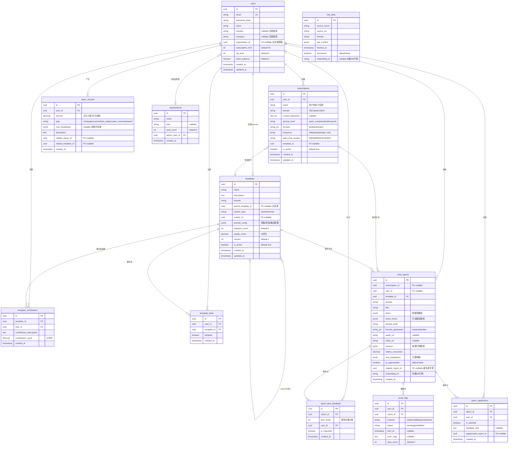

# 信息架构与数据模型

**版本**: v2.0  
**日期**: 2026-04-10  
**状态**: 草案  
**前序版本**: [14-信息架构与数据模型](../specs/14-信息架构与数据模型.md)  
**关联文档**: [22-P0核心功能PRD](./22-P0核心功能PRD.md) | [25-技术架构与选型](./25-技术架构与选型.md)

---

## 1. 站点地图

```
/                                落地页（产品介绍 + 注册入口）
├── /login                       登录
├── /register                    注册（含行业/公司可选字段）
│
├── /intel                       情报中心（登录后默认首页）
│   ├── /intel/today             今日情报流（统一展示所有订阅）
│   └── /intel/:reportId         单条报告详情 + 重生成入口
│
├── /subscriptions               订阅管理
│   ├── /subscriptions/new       创建新订阅（单页完成所有配置）
│   └── /subscriptions/:id/edit  编辑已有订阅
│
├── /cocreate                    共创中心
│   ├── /cocreate/browse         浏览配方（按采用次数排序）
│   ├── /cocreate/:id            配方详情（贡献者 + 血缘树 + 试用入口）
│   ├── /cocreate/:id/try        免费试用
│   └── /cocreate/:id/fork       分支创建
│
├── /credits                     积分管理
│   ├── /credits/balance         余额 + 每日免费额度
│   ├── /credits/recharge        充值页面
│   ├── /credits/records         消费记录
│   └── /credits/earnings        创作者收益明细
│
├── /settings                    账户设置
│   ├── /settings/profile        个人信息
│   └── /settings/notifications  通知偏好
│
└── /api/docs                    API 文档（P2+ 对外开放）
```

---

## 2. 数据库 ER 图



---

## 3. 关键字段与枚举值说明

### 3.1 `intel_reports.items` JSONB 结构

```json
[
  {
    "index": 0,
    "title": "OpenAI 发布 GPT-5 技术报告",
    "summary": "OpenAI 于4月9日发布 GPT-5 技术报告，在推理能力上较 GPT-4 提升约40%...",
    "importance_score": 9.2,
    "domain": "AI",
    "sources": [
      {"name": "arXiv", "url": "https://arxiv.org/abs/...", "fetched_at": "2026-04-10T06:00:00Z"}
    ],
    "action_items": [
      {"type": "read", "content": "阅读完整技术报告", "url": "https://..."},
      {"type": "watch", "content": "关注 GPT-5 的 API 开放时间线"}
    ]
  }
]
```

### 3.2 `templates.prompt_config` JSONB 结构

```json
{
  "collection_weights": {
    "arXiv": 0.3,
    "GitHub": 0.2,
    "HackerNews": 0.2,
    "TechCrunch": 0.15,
    "ProductHunt": 0.15
  },
  "filtering": {
    "min_relevance_score": 6,
    "max_age_hours": 48,
    "dedup_window_hours": 24,
    "focus_keywords": ["LLM", "Agent", "RAG"],
    "exclude_keywords": []
  },
  "output": {
    "analysis_framework": "技术突破 → 应用场景 → 行业影响 → 行动建议",
    "tone": "专业但易懂",
    "language": "zh-CN"
  }
}
```

### 3.3 `token_records.cost_breakdown` JSONB 结构

```json
{
  "model": "deepseek-v3",
  "input_tokens": 2500,
  "output_tokens": 1200,
  "model_input_price_per_1k": 0.001,
  "model_output_price_per_1k": 0.002,
  "raw_cost_rmb": 0.0049,
  "platform_multiplier": 15,
  "density_multiplier": 1.0,
  "credits_to_rmb_rate": 0.01,
  "final_credits": 8
}
```

---

## 4. 索引策略

| 表 | 索引 | 类型 | 用途 |
|:---|:-----|:-----|:-----|
| `users` | `email` | UNIQUE | 登录查找 |
| `subscriptions` | `(user_id, is_active)` | B-tree | 用户活跃订阅列表 |
| `subscriptions` | `(push_time_bucket, is_active)` | B-tree | 定时推送调度查询 |
| `intel_reports` | `(user_id, created_at DESC)` | B-tree | 情报历史时间线 |
| `intel_reports` | `(subscription_id, created_at DESC)` | B-tree | 按订阅查情报 |
| `intel_reports` | `(domain, created_at DESC)` | B-tree | 按领域查询 |
| `raw_data` | `(domain, fetched_at DESC)` | B-tree | 去重检查 |
| `templates` | `(domain, adoption_count DESC)` | B-tree | 配方排行 |
| `templates` | `parent_template_id` | B-tree | 血缘树查询 |
| `template_contributors` | `(template_id, contribution_score DESC)` | B-tree | 贡献者排行 |
| `template_trials` | `(user_id, template_id)` | UNIQUE | 防止重复试用 |
| `token_records` | `(user_id, created_at DESC)` | B-tree | 消费记录列表 |
| `token_records` | `(user_id, type) WHERE type='creator_revenue'` | Partial | 创作者收益查询 |
| `push_logs` | `(user_id, status)` | B-tree | 推送状态/重试 |
| `report_item_feedback` | `(user_id, report_id)` | B-tree | 用户对报告的标记 |

---

## 5. API 设计（核心端点）

### 5.1 认证

| Method | Endpoint | 描述 | 鉴权 |
|:-------|:---------|:-----|:-----|
| POST | `/api/auth/register` | 注册（邮箱+密码+可选行业/公司） | 无 |
| POST | `/api/auth/login` | 登录，返回 JWT | 无 |
| POST | `/api/auth/refresh` | 刷新 JWT | Refresh Token |

### 5.2 订阅管理

| Method | Endpoint | 描述 | 鉴权 |
|:-------|:---------|:-----|:-----|
| GET | `/api/subscriptions` | 获取当前用户所有订阅 | JWT |
| POST | `/api/subscriptions` | 创建新订阅 | JWT |
| GET | `/api/subscriptions/:id` | 获取单条订阅详情 | JWT |
| PUT | `/api/subscriptions/:id` | 更新订阅配置 | JWT |
| PATCH | `/api/subscriptions/:id/toggle` | 暂停/恢复订阅 | JWT |
| DELETE | `/api/subscriptions/:id` | 删除订阅 | JWT |

### 5.3 情报

| Method | Endpoint | 描述 | 鉴权 |
|:-------|:---------|:-----|:-----|
| GET | `/api/intel/today` | 获取今日统一情报流 | JWT |
| GET | `/api/intel/:reportId` | 获取单条报告详情 | JWT |
| GET | `/api/intel/:reportId/history` | 获取某条情报的语义关联历史脉络 | JWT |
| POST | `/api/intel/:reportId/regenerate` | 重新生成报告（每日一次，消耗积分） | JWT |
| POST | `/api/intel/:reportId/items/:index/feedback` | 标记某条情报为重要/取消 | JWT |
| GET | `/api/intel/list` | 获取情报历史列表（分页+筛选） | JWT |

### 5.4 共创中心

| Method | Endpoint | 描述 | 鉴权 |
|:-------|:---------|:-----|:-----|
| GET | `/api/templates` | 配方列表（按采用次数排序，支持领域筛选） | JWT |
| GET | `/api/templates/:id` | 配方详情（含贡献者列表） | JWT |
| GET | `/api/templates/:id/lineage` | 配方血缘树 | JWT |
| POST | `/api/templates/:id/try` | 免费试用配方 | JWT |
| POST | `/api/templates/:id/adopt` | 采用配方 | JWT |
| POST | `/api/templates/:id/fork` | 分支创建配方 | JWT |

### 5.5 积分

| Method | Endpoint | 描述 | 鉴权 |
|:-------|:---------|:-----|:-----|
| GET | `/api/credits/balance` | 查询余额（含今日免费剩余） | JWT |
| POST | `/api/credits/recharge` | 发起充值（返回支付链接） | JWT |
| POST | `/api/credits/recharge/callback` | 支付回调 | 签名验证 |
| GET | `/api/credits/records` | 消费记录（分页） | JWT |
| GET | `/api/credits/earnings` | 创作者收益明细（分页） | JWT |

### 5.6 推送管理

| Method | Endpoint | 描述 | 鉴权 |
|:-------|:---------|:-----|:-----|
| GET | `/api/push/status` | 今日推送状态 | JWT |
| POST | `/api/push/test` | 测试推送（发一条到指定渠道） | JWT |

---

## 6. 积分定价公式详解

### 6.1 公式

$$
C_{credits} = \left\lceil \frac{(T_{in} \times P_{in} + T_{out} \times P_{out}) \times M_{platform} \times M_{density}}{R_{credit}} \right\rceil
$$

### 6.2 参数表

| 参数 | 含义 | 值 | 可配置 |
|:-----|:-----|:---|:-------|
| $T_{in}$ | 输入 token 数 | 实际值 | 否（运行时计算） |
| $T_{out}$ | 输出 token 数 | 实际值 | 否（运行时计算） |
| $P_{in}$ | 模型输入单价（¥/千token） | DeepSeek=0.001, Claude=0.015 | 是 |
| $P_{out}$ | 模型输出单价（¥/千token） | DeepSeek=0.002, Claude=0.060 | 是 |
| $M_{platform}$ | 平台溢价系数 | 15 | 是 |
| $M_{density}$ | 信息密度系数 | 速览=0.6, 标准=1.0, 研究级=2.0 | 是 |
| $R_{credit}$ | 积分兑换率（¥/积分） | 0.01 | 是 |

### 6.3 计算示例

**场景**：用户生成一份标准密度AI情报，引擎使用 DeepSeek V3。

| 步骤 | 计算 |
|:-----|:-----|
| 输入 tokens | 3,000 |
| 输出 tokens | 1,500 |
| 原始成本 | (3000/1000×0.001) + (1500/1000×0.002) = 0.003 + 0.003 = ¥0.006 |
| 平台溢价 | 0.006 × 15 = ¥0.09 |
| 密度系数 | 0.09 × 1.0 = ¥0.09 |
| 换算积分 | 0.09 / 0.01 = **9积分** |

**场景2**：用户生成一份研究级AI情报，引擎混用 DeepSeek + Claude。

| 步骤 | 计算 |
|:-----|:-----|
| DeepSeek部分 | (2000/1000×0.001) + (800/1000×0.002) = ¥0.0036 |
| Claude部分 | (1500/1000×0.015) + (1000/1000×0.060) = ¥0.0825 |
| 合计原始成本 | ¥0.0861 |
| 平台溢价 | 0.0861 × 15 = ¥1.29 |
| 密度系数 | 1.29 × 2.0 = ¥2.58 |
| 换算积分 | 2.58 / 0.01 = **258积分** |

### 6.4 免费额度校准

- 每日免费积分建议值：**50积分**
- 足够生成1次标准密度报告（~9-30积分，取决于报告复杂度）
- 保留余量供用户试用配方等操作

---

## 7. 领域配置文件格式

```yaml
# domains/ai.yaml
domain:
  name: "AI"
  display_name: "人工智能"
  description: "AI行业前沿动态、论文、开源项目、产品发布"

sources:
  - name: "arXiv"
    type: "api"
    endpoint: "http://export.arxiv.org/api/query"
    params:
      search_query: "cat:cs.AI OR cat:cs.CL OR cat:cs.LG"
      max_results: 20
      sortBy: "submittedDate"
    weight: 0.3
    schedule: "daily"

  - name: "GitHub Trending"
    type: "scraper"
    url: "https://github.com/trending"
    params:
      language: "python"
      since: "daily"
    weight: 0.2
    schedule: "daily"

  - name: "HackerNews"
    type: "api"
    endpoint: "https://hacker-news.firebaseio.com/v0/topstories.json"
    params:
      limit: 30
    weight: 0.2
    schedule: "daily"

  - name: "TechCrunch"
    type: "rss"
    url: "https://techcrunch.com/category/artificial-intelligence/feed/"
    weight: 0.15
    schedule: "daily"

  - name: "Google News"
    type: "rss"
    url: "https://news.google.com/rss/search?q=artificial+intelligence&hl=zh-CN"
    weight: 0.15
    schedule: "daily"

filtering:
  min_relevance_score: 6
  max_age_hours: 48
  dedup_window_hours: 24
  compliance_filter: true
  max_items_per_density:
    quick_scan: 12
    standard: 8
    research: 3

embedding:
  model: "text-embedding-3-small"
  dimensions: 1536
  index_on_ingest: true
```

---

## 8. 向量数据库 Schema

用于语义历史脉络检索。

**存储引擎**：Chroma（本地开发）→ Pinecone（生产环境）

**Collection**: `intel_embeddings`

| 字段 | 类型 | 说明 |
|:-----|:-----|:-----|
| `id` | string | `{report_id}_{item_index}` |
| `embedding` | float[1536] | text-embedding-3-small 向量 |
| `metadata.report_id` | string | 关联报告ID |
| `metadata.item_index` | int | 报告中第N条 |
| `metadata.domain` | string | 领域 |
| `metadata.title` | string | 标题（用于展示） |
| `metadata.summary` | string | 摘要（用于展示） |
| `metadata.created_at` | string | ISO时间戳 |
| `metadata.user_id` | string | 所属用户 |

**查询接口**：

```python
def get_related_history(
    current_embedding: list[float],
    user_id: str,
    domain: str | None = None,
    top_k: int = 5,
    min_score: float = 0.7
) -> list[HistoryItem]:
    """语义检索与当前情报相关的历史条目"""
```

---

**本文档定义"数据如何组织"。用户如何与这些数据交互见 [24-用户流程图](./24-用户流程图.md)。**
