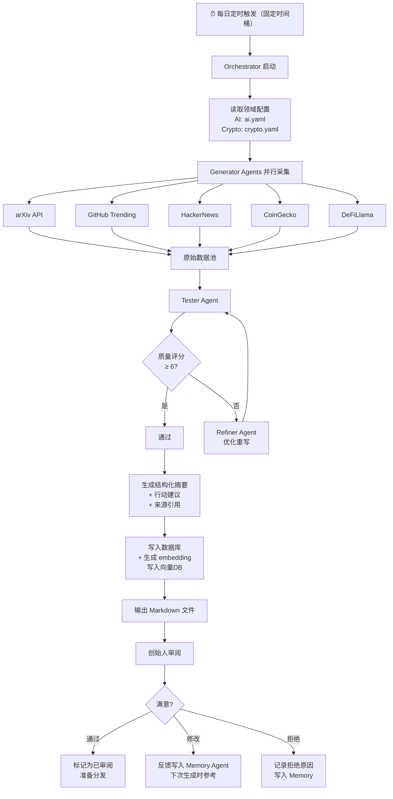
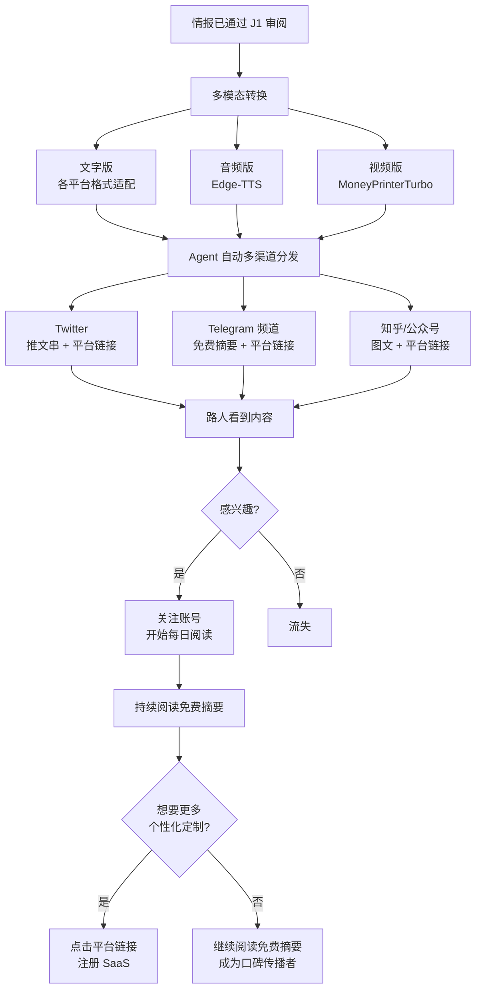
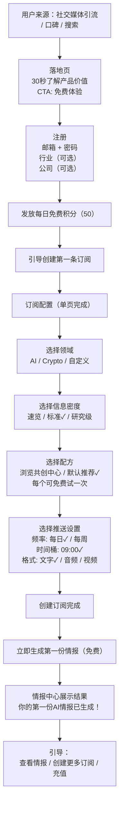
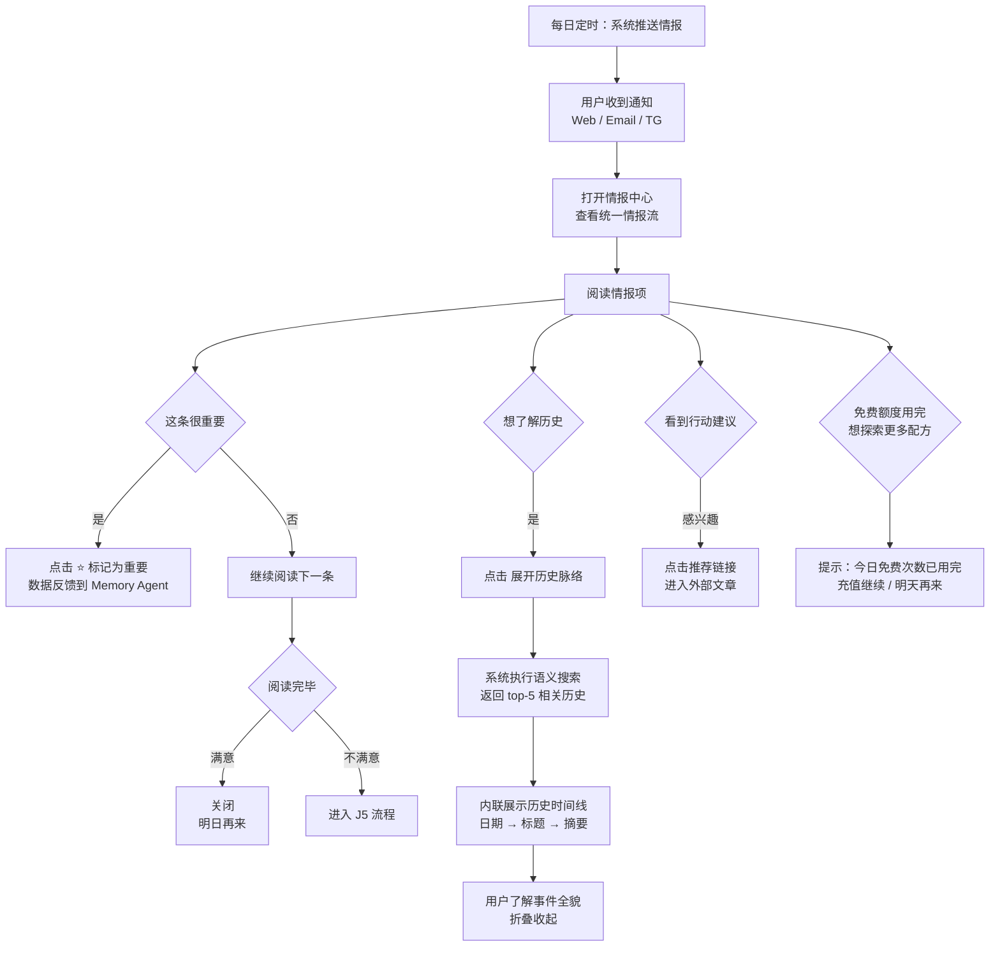
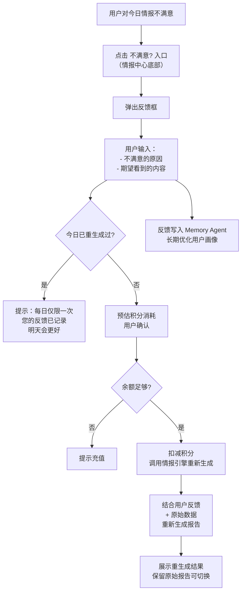
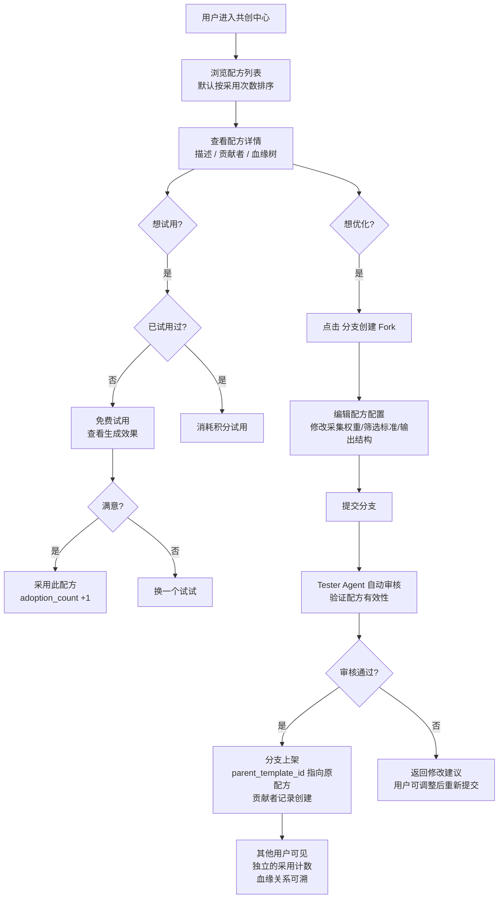
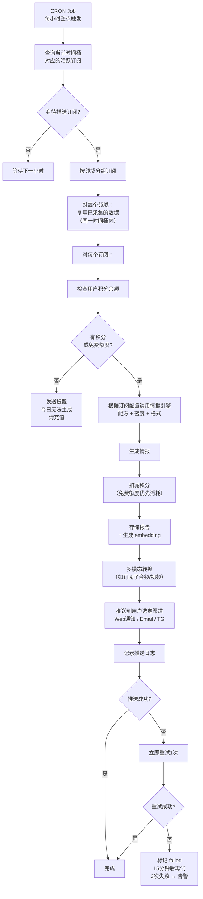
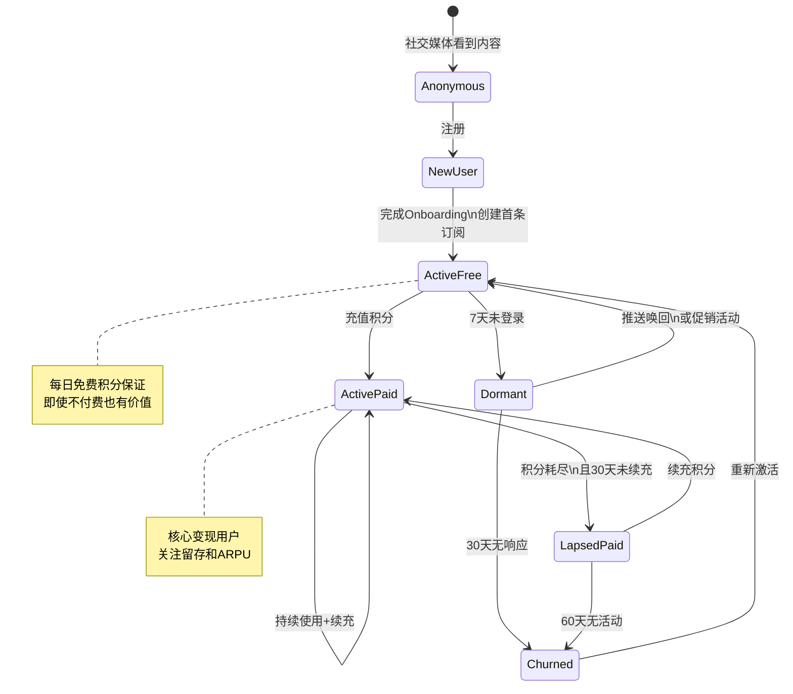

# 用户流程图

**版本**: v2.0  
**日期**: 2026-04-10  
**状态**: 草案  
**前序版本**: [15-用户流程图](../specs/15-用户流程图.md)  
**关联文档**: [22-P0核心功能PRD](./22-P0核心功能PRD.md) | [23-信息架构与数据模型](./23-信息架构与数据模型.md)

---

## 1. 核心用户旅程概览

| # | 旅程 | 用户角色 | Phase | 关联功能域 |
|:--|:-----|:---------|:------|:----------|
| J1 | 创始人自用：情报生成与审阅 | 创始人 | Phase 1 | F1 |
| J2 | 社交媒体推广流程 | 路人→关注者 | Phase 2 | F6, F7 |
| J3 | 新用户注册→创建订阅→首次推送 | SaaS新用户 | Phase 3 | F2, F4, F5 |
| J4 | 日常阅读：推送→标记重要→展开历史 | SaaS用户 | Phase 3 | F4 |
| J5 | 不满意→反馈→重生成 | SaaS用户 | Phase 3 | F4 |
| J6 | 共创：浏览配方→分支→提交 | 共创者 | Phase 3 | F3 |
| J7 | 系统内部：每日推送调度 | 系统 | Phase 3 | F1, F5 |
| J8 | 用户生命周期状态机 | 全部 | 全Phase | — |

---

## 2. J1 — 创始人自用：情报生成与审阅（Phase 1）

---

## 3. J2 — 社交媒体推广流程（Phase 2）

**关键设计**：社交媒体不设付费订阅，所有内容免费展示，末尾附平台引流链接。

---

## 4. J3 — 新用户注册→创建订阅→首次推送（Phase 3）

**关键设计**：
- Onboarding 必须 < 2分钟完成
- 所有配置在一个页面/流程中完成
- 首份情报免费且立即生成，让用户看到即时价值

---

## 5. J4 — 日常阅读：推送→标记重要→展开历史（Phase 3）

---

## 6. J5 — 不满意→反馈→重生成（Phase 3）

---

## 7. J6 — 共创：浏览配方→分支→提交（Phase 3）

---

## 8. J7 — 系统内部：每日推送调度（Phase 3）

---

## 9. J8 — 用户生命周期状态机

**关键转化漏斗**：

| 转化节点 | 目标转化率 | 关键动作 |
|:---------|:----------|:---------|
| Anonymous → NewUser | 3-5% | 落地页优化 + 社交媒体引流 |
| NewUser → ActiveFree | 80%+ | Onboarding < 2分钟 + 即时首份情报 |
| ActiveFree → ActivePaid | 5-10% | 免费额度用完后的转化引导 |
| ActivePaid 月留存 | >80% | 每日推送触达 + 历史价值积累 + 重要性反馈闭环 |
| ActivePaid → LapsedPaid | <20% | 积分余额提醒 + 续充优惠 |

---

**本文档定义"用户如何与产品交互"。底层技术实现见 [25-技术架构与选型](./25-技术架构与选型.md)。**
