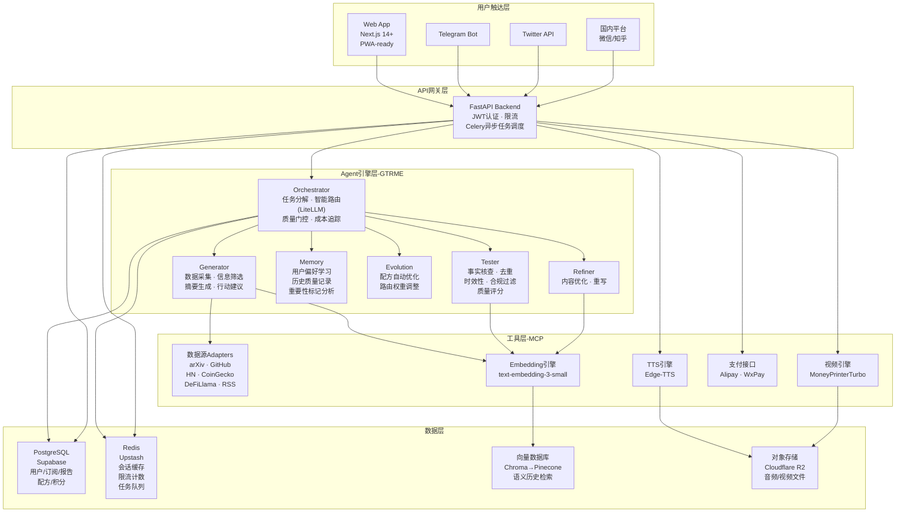
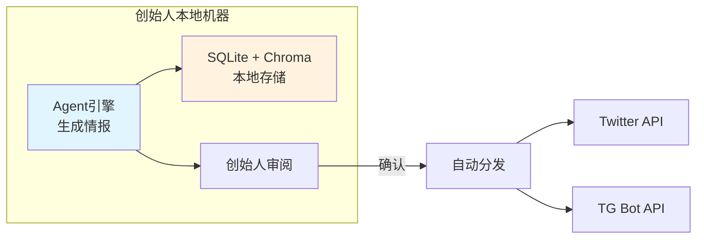
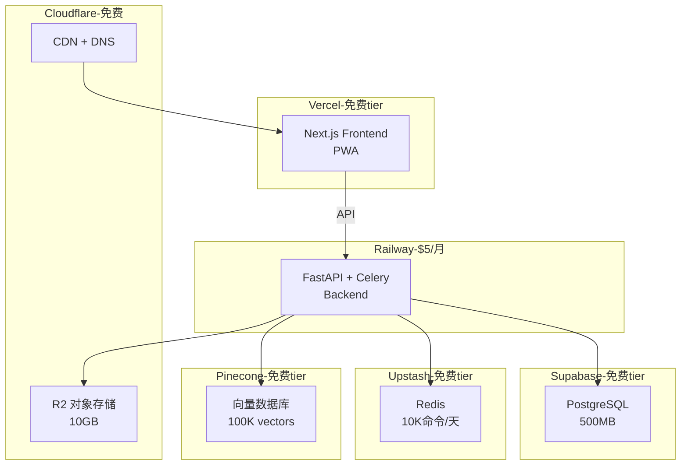
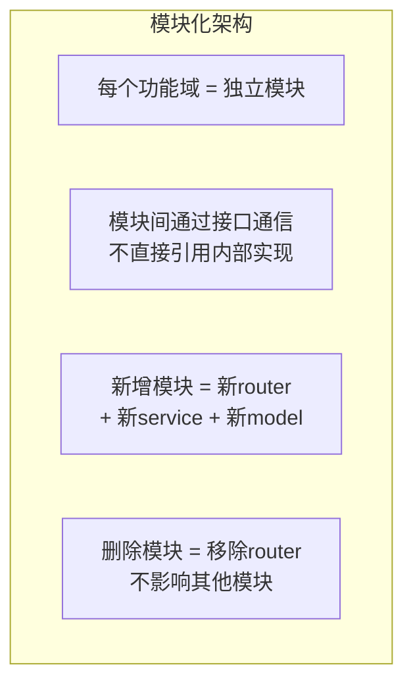

# 技术架构与选型

**版本**: v2.0  
**日期**: 2026-04-10  
**状态**: 草案  
**前序版本**: [16-技术架构与选型](../specs/16-技术架构与选型.md)  
**关联文档**: [23-信息架构与数据模型](./23-信息架构与数据模型.md) | [22-P0核心功能PRD](./22-P0核心功能PRD.md)

---

## 1. 架构总览



---

## 2. 技术栈选型

### 2.1 前端

| 组件 | 选型 | 理由 |
|:-----|:-----|:-----|
| 框架 | **Next.js 14+ (App Router)** | SSR/SSG混合、API Routes、Cursor代码生成质量最高 |
| UI库 | **Tailwind CSS + shadcn/ui** | 快速开发、美观、可定制、组件丰富 |
| 状态管理 | **Zustand** | 轻量、TypeScript友好、无样板代码 |
| 图表 | **Recharts** | React原生、简单易用 |
| PWA | **next-pwa** | 支持离线缓存、推送通知、类App体验 |
| 部署 | **Vercel** | Next.js原生支持、免费tier |

**PWA优先策略**：用户希望"像打开App一样"使用产品。PWA可通过一套代码实现Web+类App体验（添加到主屏幕、推送通知、离线基础功能），开发成本远低于React Native。如果用户量增长到需要原生App时，再评估迁移。

### 2.2 后端

| 组件 | 选型 | 理由 |
|:-----|:-----|:-----|
| 框架 | **FastAPI (Python)** | async原生、类型安全、与AI生态无缝对接 |
| 任务队列 | **Celery + Redis** | 定时推送调度、异步Agent任务 |
| 认证 | **JWT (PyJWT)** | 简单、无状态、前后端分离 |
| ORM | **SQLAlchemy 2.0 + Alembic** | 类型安全、迁移管理、异步支持 |
| 部署 | **Railway** | 免费tier起步、一键部署、自动CI/CD |

### 2.3 Agent 引擎

| 组件 | 选型 | 理由 |
|:-----|:-----|:-----|
| Agent框架 | **LangGraph** | 有向图工作流、支持分支/循环/并行、状态管理 |
| LLM路由 | **LiteLLM** | 统一API适配100+ LLM、自动fallback、成本追踪 |
| 主力LLM | **DeepSeek V3**（≥80%任务） | ¥0.001/千input token、中文能力强、成本极低 |
| 高级LLM | **Claude Sonnet**（≤20%任务） | 复杂分析/生成质量上限高 |
| 工具协议 | **MCP (Model Context Protocol)** | Agent↔Tool标准化接口 |
| Embedding | **text-embedding-3-small (OpenAI)** | 1536维、成本低、质量稳定 |

### 2.4 数据库

| 组件 | 选型 | 理由 |
|:-----|:-----|:-----|
| 主数据库 | **PostgreSQL (Supabase)** | 免费500MB、Auth可选用、实时订阅 |
| 缓存 | **Redis (Upstash)** | 免费10K命令/天、Serverless |
| 向量数据库 | **Chroma（开发）→ Pinecone（生产）** | Chroma本地零成本调试、Pinecone生产级性能 |
| 对象存储 | **Cloudflare R2**（国际）/ **阿里OSS**（国内） | R2免出站费、OSS国内快 |

### 2.5 多模态

| 组件 | 选型 | 理由 |
|:-----|:-----|:-----|
| TTS | **Edge-TTS**（微软免费） | 免费、质量高、多语言多角色 |
| 视频 | **MoneyPrinterTurbo** | 开源50K+ Stars、全自动文字→视频 |
| 备选TTS | **阿里通义TTS** | 国内延迟低、中文效果好 |

### 2.6 第三方服务

| 服务 | 选型 | 用途 |
|:-----|:-----|:-----|
| 社交发布 | **Twitter API v2** | 自动发推 |
| Bot | **python-telegram-bot** | TG Bot SDK |
| 支付 | **支付宝当面付 + 微信H5支付** | 国内收款 |
| 监控 | **Sentry（免费tier）** | 错误追踪 |
| 日志 | **Logfire / 本地JSON日志** | Agent运行日志+成本追踪 |
| DNS/CDN | **Cloudflare** | 免费DNS+CDN+R2 |

---

## 3. 项目仓库结构

```
intel-engine/
├── README.md
├── .env.example
├── docker-compose.yml               # 本地开发（PG + Redis + Chroma）
│
├── frontend/                        # Next.js Web App (PWA)
│   ├── package.json
│   ├── next.config.js
│   ├── tailwind.config.js
│   ├── next-pwa.config.js
│   ├── public/
│   │   └── manifest.json            # PWA manifest
│   ├── app/
│   │   ├── layout.tsx
│   │   ├── page.tsx                  # 落地页
│   │   ├── (auth)/
│   │   │   ├── login/page.tsx
│   │   │   └── register/page.tsx
│   │   ├── intel/                    # 情报中心
│   │   │   ├── page.tsx              # 今日情报流
│   │   │   └── [reportId]/page.tsx   # 报告详情+重生成
│   │   ├── subscriptions/            # 订阅管理
│   │   │   ├── page.tsx              # 订阅列表
│   │   │   ├── new/page.tsx          # 创建订阅
│   │   │   └── [id]/edit/page.tsx    # 编辑订阅
│   │   ├── cocreate/                 # 共创中心
│   │   │   ├── page.tsx              # 配方浏览
│   │   │   └── [id]/page.tsx         # 配方详情+试用+Fork
│   │   ├── credits/                  # 积分管理
│   │   │   ├── page.tsx              # 余额总览
│   │   │   ├── recharge/page.tsx     # 充值
│   │   │   ├── records/page.tsx      # 消费记录
│   │   │   └── earnings/page.tsx     # 创作者收益
│   │   └── settings/                 # 账户设置
│   │       └── page.tsx
│   ├── components/
│   │   ├── ui/                       # shadcn/ui 基础组件
│   │   ├── intel/
│   │   │   ├── report-card.tsx       # 情报项卡片
│   │   │   ├── history-timeline.tsx  # 历史脉络展开
│   │   │   ├── importance-btn.tsx    # 重要性标记按钮
│   │   │   └── regen-dialog.tsx      # 重生成对话框
│   │   ├── subscriptions/
│   │   │   ├── sub-card.tsx          # 订阅卡片
│   │   │   └── sub-form.tsx          # 订阅配置表单
│   │   ├── cocreate/
│   │   │   ├── template-card.tsx     # 配方卡片
│   │   │   ├── lineage-tree.tsx      # 血缘树可视化
│   │   │   └── fork-dialog.tsx       # 分支创建对话框
│   │   └── onboarding-wizard.tsx     # 新用户引导
│   └── lib/
│       ├── api.ts                    # API客户端
│       ├── auth.ts                   # 认证工具
│       └── store.ts                  # Zustand store
│
├── backend/                          # FastAPI Backend
│   ├── requirements.txt
│   ├── main.py                       # FastAPI 入口
│   ├── config.py                     # 配置管理（所有可调参数）
│   ├── models/                       # SQLAlchemy 模型
│   │   ├── __init__.py
│   │   ├── user.py
│   │   ├── subscription.py           # 订阅（替代原preference）
│   │   ├── template.py               # 配方（含分支关系）
│   │   ├── template_contributor.py
│   │   ├── report.py
│   │   ├── token_record.py
│   │   ├── feedback.py               # 重要性标记+满意度
│   │   └── push_log.py
│   ├── routers/                      # API 路由
│   │   ├── auth.py
│   │   ├── subscriptions.py
│   │   ├── intel.py
│   │   ├── templates.py
│   │   ├── credits.py
│   │   └── push.py
│   ├── services/                     # 业务逻辑
│   │   ├── intel_service.py          # 情报生成编排
│   │   ├── subscription_service.py
│   │   ├── template_service.py       # 含分支/分成逻辑
│   │   ├── credits_service.py        # 含公式计费逻辑
│   │   ├── push_service.py
│   │   ├── payment_service.py
│   │   ├── feedback_service.py
│   │   └── history_service.py        # 语义历史检索
│   ├── tasks/                        # Celery 异步任务
│   │   ├── daily_push.py             # 定时推送调度
│   │   ├── daily_free_credits.py     # 每日免费积分发放
│   │   └── creator_revenue.py        # 创作者收益结算
│   ├── utils/
│   │   ├── llm_router.py
│   │   ├── compliance_filter.py
│   │   ├── pricing.py                # 积分公式计算
│   │   └── embedding.py              # Embedding生成+向量DB操作
│   └── migrations/                   # Alembic 迁移
│
├── agents/                           # GTRME Agent 引擎
│   ├── orchestrator.py
│   ├── generator.py
│   ├── tester.py
│   ├── refiner.py
│   ├── memory.py
│   ├── evolution.py
│   ├── graph.py                      # LangGraph 工作流定义
│   └── tools/                        # MCP Tools
│       ├── arxiv_tool.py
│       ├── github_tool.py
│       ├── hackernews_tool.py
│       ├── coingecko_tool.py
│       ├── defi_llama_tool.py
│       ├── etherscan_tool.py
│       ├── google_news_tool.py
│       ├── tts_tool.py
│       ├── video_tool.py
│       ├── twitter_tool.py
│       └── telegram_tool.py
│
├── domains/                          # 领域配置
│   ├── ai.yaml
│   ├── crypto.yaml
│   └── _template.yaml
│
├── templates/                        # 初始配方定义
│   ├── ai_daily_digest.yaml
│   ├── ai_github_trending.yaml
│   ├── ai_paper_highlights.yaml
│   ├── crypto_market_brief.yaml
│   ├── crypto_defi_digest.yaml
│   └── crypto_onchain_signals.yaml
│
├── distribution/                     # 多渠道分发
│   ├── twitter_publisher.py
│   ├── telegram_publisher.py
│   ├── wechat_publisher.py
│   └── formatter.py
│
├── media/                            # 多模态转换
│   ├── tts_engine.py
│   └── video_engine.py
│
├── scripts/
│   ├── init_db.py
│   ├── seed_templates.py
│   └── run_daily.py
│
└── tests/
    ├── test_agents/
    ├── test_api/
    ├── test_services/
    └── test_tools/
```

---

## 4. 部署架构

### 4.1 Phase 1-2（本地开发，最低成本）



**月成本**：¥0-50（仅LLM API费用）

### 4.2 Phase 3（SaaS上线）



**月成本估算**：

| 项目 | 费用 |
|:-----|:-----|
| Vercel | ¥0（免费tier） |
| Railway | ¥0-35（$0-5） |
| Supabase | ¥0（免费tier） |
| Upstash | ¥0（免费tier） |
| Cloudflare | ¥0（免费DNS+CDN+R2） |
| Pinecone | ¥0（免费tier 100K向量） |
| LLM API | ¥50-200（按用户量） |
| Embedding API | ¥10-50 |
| 域名 | ¥50-100/年 |
| **合计** | **¥60-300/月** |

### 4.3 Phase 5（规模化，按需升级）

| 组件 | 升级方案 | 费用 |
|:-----|:---------|:-----|
| Vercel Pro | 更多带宽/构建 | $20/月 |
| Railway Pro | 更多CPU/内存 | $20/月 |
| Supabase Pro | 8GB数据库 | $25/月 |
| Pinecone Standard | 更多向量 | $70/月 |
| LLM API | 按量增长 | ¥500-2000/月 |
| **合计** | | **¥1000-3000/月** |

---

## 5. 开发里程碑（基于3h/天）

### Phase 1: Agent引擎 + 自用（Week 1-3，~63h）

| Day | 任务 | 交付物 |
|:----|:-----|:-------|
| 1 | 搭建项目结构、docker-compose（PG+Redis+Chroma）、环境变量 | 可运行的空项目 |
| 2 | Generator Agent — arXiv + GitHub + HN 数据源 | 能采集AI领域原始数据 |
| 3 | Tester Agent — 去重+时效性+质量评分 | 能过滤低质量内容 |
| 4 | Orchestrator + LangGraph工作流 | Generator→Tester→输出 |
| 5 | 智能路由（LiteLLM, DeepSeek+Claude） | 成本优化生效 |
| 6 | AI领域端到端测试 + Prompt优化 | 第一份AI日报 |
| 7 | Crypto数据源（CoinGecko+DeFiLlama+Etherscan） | Crypto日报可用 |
| 8 | 配方系统基础（YAML配置→Agent行为） | 3个AI配方+3个Crypto配方 |
| 9 | 行动建议生成 + 数据源引用 | 每条情报有建议和来源 |
| 10 | 结构化存储（PostgreSQL）+ Embedding生成入库 | 数据持久化+向量索引 |
| 11-12 | Refiner Agent + Memory Agent基础 | 质量闭环 |
| 13-15 | 情报质量迭代优化（根据创始人审阅反馈） | 稳定的高质量日报 |

**里程碑 M1**：创始人每日自动收到AI+Crypto情报，主观评价"比手动好"

### Phase 2: 多模态 + 多渠道推广分发（Week 4-6，~63h）

| Day | 任务 | 交付物 |
|:----|:-----|:-------|
| 16 | Edge-TTS集成 | 情报→音频 |
| 17 | MoneyPrinterTurbo集成 | 情报→视频 |
| 18-19 | Twitter API + 自动发推 + 格式适配 | Twitter分发可用 |
| 20-21 | Telegram Bot（/start, /subscribe, 推送） | TG Bot可用 |
| 22 | 国内平台接入（微信公众号或知乎，选1） | 至少1个国内渠道 |
| 23-24 | 多渠道分发编排 + 格式优化 | 一键全渠道分发 |
| 25-27 | 内容质量优化 + 社交媒体运营启动 | 首批内容发布 |

**里程碑 M2**：社交媒体自动分发运行，首批粉丝增长

### Phase 3: SaaS Web平台（Week 7-14，~168h）

| Day | 任务 | 交付物 |
|:----|:-----|:-------|
| 28-30 | Next.js项目搭建 + 落地页 + 注册/登录 + PWA配置 | 可访问的Web App |
| 31-33 | FastAPI后端 + 认证API + 数据库迁移到Supabase | API可调用 |
| 34-36 | 订阅管理页面 + API（CRUD + 配置表单） | 订阅系统可用 |
| 37-39 | 情报中心页面 + 统一情报流 + Celery定时推送 | 自动推送可用 |
| 40-42 | 历史脉络展开（向量检索集成）+ 重要性标记 | 核心交互完成 |
| 43-44 | 不满意重生成功能 | 质量反馈闭环 |
| 45-47 | 共创中心页面（浏览+试用+采用+分支） | 共创系统可用 |
| 48-50 | 积分系统（公式计费+充值+消费记录+创作者收益） | 积分系统完成 |
| 51-52 | 支付集成（支付宝/微信） | 充值可用 |
| 53-56 | 集成测试 + Bug修复 + 性能优化 + UI打磨 | 生产就绪 |

**里程碑 M3**：SaaS平台上线（Beta），可注册、订阅、接收推送、付费

---

## 6. 关键技术决策记录

| # | 决策 | 选项 | 结论 | 理由 |
|:--|:-----|:-----|:-----|:-----|
| TD-1 | Agent框架 | LangGraph vs CrewAI vs AutoGen | **LangGraph** | 有向图最适合GTRME工作流，精细控制分支/循环 |
| TD-2 | 后端语言 | Python vs TypeScript | **Python** | AI生态全在Python，无需跨语言 |
| TD-3 | 前端框架 | Next.js vs Nuxt vs SvelteKit | **Next.js** | 生态最大、Vercel免费、Cursor效率最高 |
| TD-4 | 数据库 | PostgreSQL vs MongoDB | **PostgreSQL** | 结构化数据为主、关系查询多、Supabase免费 |
| TD-5 | 主力LLM | DeepSeek vs GPT-4o-mini vs Gemini Flash | **DeepSeek V3** | 成本最低、中文质量好 |
| TD-6 | Phase 1存储 | SQLite vs Supabase | **SQLite起步** | 本地零成本，Phase 3迁移Supabase |
| TD-7 | 视频生成 | MoneyPrinterTurbo vs 自研 | **MPTurbo** | 开源成熟、功能完整 |
| TD-8 | 部署策略 | Serverless vs 自托管 | **Serverless优先** | 免费tier起步、零运维 |
| TD-9 | 向量数据库 | Chroma vs Milvus vs Pinecone | **Chroma(开发)+Pinecone(生产)** | Chroma本地零成本调试；Pinecone免费100K向量、托管无运维 |
| TD-10 | App形态 | PWA vs React Native vs Flutter | **PWA优先** | 一套代码、零额外开发成本、支持推送通知和主屏幕图标。用户量增长后再评估原生 |
| TD-11 | 配方血缘数据结构 | 邻接表 vs 嵌套集 vs 物化路径 | **邻接表（parent_id）** | 最简单、查询深度有限（通常≤5层）、递归CTE可处理 |
| TD-12 | Embedding模型 | OpenAI ada vs text-3-small vs 开源 | **text-embedding-3-small** | 1536维、成本$0.02/百万token、质量稳定 |

---

## 7. 安全与合规

| 维度 | 措施 |
|:-----|:-----|
| 认证 | JWT + HttpOnly Cookie + HTTPS |
| 密码 | bcrypt 加密存储 |
| API安全 | 限流（100次/分钟/用户）+ CORS白名单 |
| 数据隔离 | 所有查询带 `user_id` 过滤，严格行级隔离 |
| 内容合规 | Tester Agent合规过滤 + AI生成内容标注 + 创始人审阅 |
| 支付安全 | 支付回调签名验证 + 幂等性处理 + HTTPS only |
| 隐私保护 | 最小数据采集原则、中国个保法基本合规 |
| 积分安全 | 充值和消耗操作数据库事务原子性、防并发扣减 |

---

## 8. 监控与可观测性

| 层 | 工具 | 监控内容 |
|:---|:-----|:---------|
| 应用 | Sentry（免费tier） | 异常捕获、错误率、性能追踪 |
| Agent | JSON日志 + Logfire | 运行日志、成本追踪（每次调用的model/tokens/cost）、质量评分 |
| 基础设施 | Railway/Vercel Dashboard | CPU/内存/带宽/响应时间 |
| 业务 | 自建Dashboard（Recharts） | 注册数、DAU、付费率、推送成功率、ARPU、配方采用分布 |
| 积分 | 自建 | 每日积分流入/流出、免费额度消耗率、充值转化率 |

---

## 9. 数据库容量估算

### 假设前提

| 时间点 | 注册用户 | DAU | 日活订阅数 | 日生成报告数 |
|:-------|:---------|:----|:----------|:------------|
| 3个月 | 200 | 50 | 80 | 80 |
| 6个月 | 1,000 | 200 | 400 | 400 |
| 12个月 | 5,000 | 1,000 | 2,000 | 2,000 |

### 存储估算

| 数据类型 | 单条大小 | 3个月 | 6个月 | 12个月 |
|:---------|:---------|:------|:------|:-------|
| `intel_reports` | ~5KB | 12MB | 60MB | 360MB |
| `raw_data` | ~2KB | 50MB | 200MB | 800MB |
| `token_records` | ~0.5KB | 5MB | 30MB | 150MB |
| 向量索引（Pinecone） | ~6KB/向量 | 5MB | 50MB | 300MB |
| 音频文件（R2） | ~2MB/个 | 5GB | 25GB | 100GB |
| 视频文件（R2） | ~20MB/个 | 10GB | 50GB | 200GB |
| **PostgreSQL合计** | | **~70MB** | **~300MB** | **~1.5GB** |
| **对象存储合计** | | **~15GB** | **~75GB** | **~300GB** |

**结论**：Supabase免费tier（500MB）可撑到约6个月。之后升级Pro（$25/月，8GB）可撑到12个月+。对象存储R2免费10GB可撑3个月，之后按量计费（$0.015/GB/月）。

---

## 10. 架构可扩展性设计

### 10.1 模块化原则

用户明确要求架构支持**快速增删功能**。采用以下设计原则：



**具体实践**：

| 原则 | 实现方式 |
|:-----|:---------|
| 路由独立 | 每个功能域一个 `router` 文件，通过 `app.include_router()` 注册 |
| 业务隔离 | 每个功能域一个 `service` 文件，service之间通过函数参数传递，不共享全局状态 |
| 模型独立 | 每个功能域一个 `model` 文件，通过 SQLAlchemy 关系建立联系 |
| 配置外置 | 所有可调参数（积分公式系数、免费额度、时间桶等）集中在 `config.py`，无需改代码 |
| Agent可插拔 | 每个Agent（Generator/Tester/Refiner）是独立 Python 模块，通过 LangGraph 节点注册 |
| 数据源可插拔 | 每个数据源一个 `tool` 文件 + YAML配置，新增数据源 = 新增文件 + 配置条目 |

### 10.2 用户要求的"从一开始就用最优方法"

| 领域 | 最优实践 | 说明 |
|:-----|:---------|:-----|
| 代码组织 | 分层架构（router → service → model） | 避免业务逻辑写在路由里 |
| 数据库 | SQLAlchemy 2.0 + Alembic 迁移 | 从Day 1管理schema变更 |
| 配置 | Pydantic Settings + .env | 类型安全的配置管理 |
| 类型安全 | Python type hints 全覆盖 + TypeScript strict | 减少运行时错误 |
| 测试 | pytest + 每个service一个测试文件 | 不要求100%覆盖，但关键路径必须有 |
| API设计 | RESTful + Pydantic schema + OpenAPI自动文档 | 前后端契约清晰 |
| Git | 主干开发 + feature branch | 简单有效 |

---

## 11. 五份文档关联总览

| 文档 | 回答的问题 |
|:-----|:----------|
| [21-产品愿景与定位](./21-产品愿景与定位.md) | 为什么做？为谁做？ |
| [22-P0核心功能PRD](./22-P0核心功能PRD.md) | 做什么？ |
| [23-信息架构与数据模型](./23-信息架构与数据模型.md) | 数据怎么组织？ |
| [24-用户流程图](./24-用户流程图.md) | 用户怎么用？ |
| [本文档](./25-技术架构与选型.md) | 怎么建？ |

---

**specs_v2 全部五份文档编写完成。这套规格书可直接交给 Code Agent 执行开发。**
